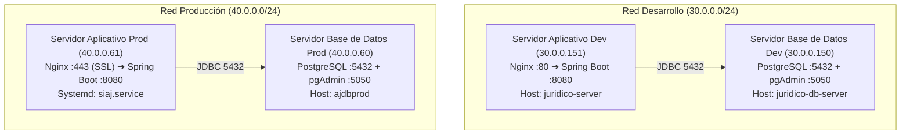

# 🤖 Manual de Operaciones y Arquitectura para Agentes - SIAJ

Este documento consolida la arquitectura técnica, topología de infraestructura, políticas de seguridad y flujos de despliegue del **Sistema Integral de Agenda Jurídica (SIAJ)**. Cualquier agente o ingeniero que opere en este repositorio o en los servidores remotos debe apegarse estrictamente a estas directrices.

---

## 🌐 1. Topología de Infraestructura y Servidores

El sistema opera en dos redes privadas aisladas (ambientes *air-gapped* sin salida directa a internet):



### Tabla Resumen de Conectividad

| Componente | IP | Usuario SSH | Rol / Servicio | Tecnologías Clave |
| :--- | :--- | :--- | :--- | :--- |
| **BD Desarrollo** | `30.0.0.150` | `agendajuridicodbdev` | Motor PostgreSQL + pgAdmin | Docker, Postgres latest, Named Volume |
| **App Desarrollo** | `30.0.0.151` | `agendajuridicoappdev` | Backend Spring Boot + Nginx | Java 17/21, Nginx (puerto 80), `deploy.sh` |
| **BD Producción** | `40.0.0.60` | `ajdbprod` | Motor PostgreSQL + pgAdmin | Docker, Postgres 15-alpine, Named Volume |
| **App Producción** | `40.0.0.61` | `ajappprod` | Backend Spring Boot + Nginx SSL | Java 17/21, Nginx (443 SSL), Systemd `siaj.service` |

---

## 🛡️ 2. Reglas Críticas de Seguridad y Operación (Lectura Obligatoria)

1. **ARCHIVOS TRAMPA / HONEYPOT DE EDR (NO TOCAR BAJO NINGUNA CIRCUNSTANCIA):**
   * En los 4 servidores está instalado el software de seguridad institucional en `/opt/apps/hisec-endpoint` (Huawei / Sangfor HiSec Endpoint EDR).
   * Existen directorios trampa como `~/Documents/`, `~/.!9m7EmrJj` y `~/.zMq4qsa5T` con archivos señuelo (`Sensitive Contracts`, `Personal Secret`, etc.).
   * **NUNCA modificar, renombrar ni eliminar estos archivos/directorios**, ya que dispararán alertas críticas de ransomware en la consola de seguridad institucional.

2. **COMPORTAMIENTO DE LA CARPETA `~/.vscode-server`:**
   * La extensión *Remote - SSH* de VS Code descarga y arranca automáticamente este agente en el servidor cada vez que un usuario se conecta desde su cliente.
   * No debe intentarse eliminar en bucle mientras exista una sesión remota activa. Para ocultarla en el explorador visual, agregar a `settings.json`: `"files.exclude": { "**/.vscode-server": true }`.

3. **MANEJO DE CONTRASEÑAS CON CARACTERES ESPECIALES (`$` y `#`):**
   * En contraseñas como `DBag3$#38`, bash interpreta `$#` como número de argumentos (`0`), corrompiendo la clave a `DBag3038`.
   * **Regla estricta:** Todas las contraseñas en scripts Bash o archivos `.env` deben ir entre comillas simples: `DB_PASSWORD='DBag3$#38'`.

4. **POLÍTICA DE USUARIOS INSTITUCIONALES DE BASE DE DATOS:**
   * **NUNCA utilizar `villalobos_admin`:** Ese rol quedó completamente deprecado y eliminado del motor de base de datos.
   * En Desarrollo: Superusuario oficial **`agendajuridicodbdev`** (Base: `sistema_juridico`).
   * En Producción: Administrador **`siaj_postgres_admin`**, aplicativo **`siaj_app`** y paridad institucional **`agendajuridicodbdev`** (Base: `siaj`).

---

## 📁 3. Estructura Homogénea en Servidores de Base de Datos

Ambos servidores de BD (`30.0.0.150` y `40.0.0.60`) operan con una estructura de directorios 100% idéntica y simétrica:

```text
/home/<usuario>/
├── installers/                   <--- Imágenes Docker offline (.tar) conservadas para contingencias
│   ├── pgadmin4-latest.tar
│   ├── postgres-15-alpine.tar
│   └── postgres-latest.tar (en Dev)
│
├── siaj/                         <--- Raíz oficial del servicio de Base de Datos
│   ├── docker-compose.yml        <--- Orquestación con volúmenes nombrados (external: true)
│   ├── .env                      <--- Variables de entorno (permisos 600)
│   ├── README.md                 <--- Manual operativo del servidor
│   ├── backups/                  <--- Dumps históricos fechados (.dump / .sql)
│   ├── init/                     <--- Scripts de aprovisionamiento en frío (/docker-entrypoint-initdb.d/)
│   │   └── 00-*.sh
│   └── scripts/
│       └── ops/                  <--- Utilidades operativas (auditoría de grants, reset de admin)
│
└── [Archivos de Sistema y EDR]   <--- .bashrc, .ssh, .!*, .z*, Documents
```

### Gestión de Volúmenes Docker en Base de Datos:
* **Producción:** Opera con volúmenes gestionados por Docker: `siaj_postgres_data` y `siaj_pgadmin_data`. Ya no existen carpetas con permisos conflictivos de root (`./postgres-data`) en el host.
* **Desarrollo:** Opera con el volumen `agendajuridicodbdev_postgres_data`.

---

## ⚙️ 4. Estructura y Operación en Servidores de Aplicativo

### Servidor de Producción (`40.0.0.61`):
* **Binario JAR:** `/home/ajappprod/siaj/app/siaj.jar`
* **Servicio Systemd:** `siaj.service` (`sudo systemctl restart siaj`)
* **Variables de Entorno:** `/etc/siaj/siaj.env`
* **Configuración Hibernate:** `/home/ajappprod/siaj/config/application.properties` (`spring.jpa.hibernate.ddl-auto=validate`)
* **Certificados SSL:** `/home/ajappprod/certs/` (permisos de carpeta `0700`, llaves `0600`)
* **Nginx:** Proxy inverso en puerto 443 HTTPS hacia `http://127.0.0.1:8080` para `siaj.finabien.gob.mx`

### Servidor de Desarrollo (`30.0.0.151`):
* **Binario JAR:** `/opt/siaj/app/sistema-juridico.jar`
* **Directorio Uploads:** `/opt/siaj/app/uploads/` (con symlink `~/uploads -> /opt/siaj/app/uploads` para paridad con Nginx)
* **Script de Despliegue:** `/home/agendajuridicoappdev/deploy.sh` (mantiene máximo los 3 últimos JARs y rota `app.log` preventivamente)
* **Logs:** `/opt/siaj/logs/app.log`

---

## 🚀 5. Flujo de Despliegue Automatizado (`deploy.ps1`)

El proyecto se despliega localmente utilizando el pipeline en PowerShell [`deploy.ps1`](file:///C:/Users/Rodrigo.DESKTOP-2MLHEH3/.codex/worktrees/siaj-alcance-1-semaforos\juridico-springboot/deploy.ps1):

```powershell
# Desplegar a Desarrollo (compila con Maven y transfiere vía SCP a 30.0.0.151)
.\deploy.ps1 -Env dev

# Desplegar a Producción (solicita confirmación interactiva, respalda JAR y reinicia siaj.service en 40.0.0.61)
.\deploy.ps1 -Env prod

# Desplegar sin recompilar (usando el último JAR existente en /target)
.\deploy.ps1 -Env dev -SkipBuild
```

---

## 🗺️ 6. Estado de Arquitectura de Base de Datos (Camino B Implementado)

El proyecto completó exitosamente la transición al **Camino B** (Migraciones formales Flyway + Hibernate `validate`):

1. **Única Fuente de Verdad:**
   - La estructura completa de la base de datos reside en migraciones versionadas bajo `src/main/resources/db/migration/`:
     - `V1__baseline_siaj.sql`: Baseline de esquema DDL completo con restricciones XOR, foreign keys, secuencias e índices.
     - `V2__catalogo_datos_iniciales.sql`: Carga idempotente de perfiles de alerta y recordatorios.
   - Tabla de control: `public.flyway_schema_history`.

2. **Validación de Hibernate:**
   - Configuración activa: `spring.jpa.hibernate.ddl-auto=validate`.
   - Hibernate ya no altera tablas ni crea restricciones en tiempo de ejecución. Si el esquema difiere de las entidades, la aplicación falla explícitamente en el arranque.

3. **Retiro de DDL en el Arranque Java:**
   - `DatabaseSchemaCompatibilityInitializer`: Deshabilitado por defecto mediante `@ConditionalOnProperty(name = "app.legacy-schema-compatibility.enabled", havingValue = "true")`.
   - `AtencionTemporalInitializer`: Deshabilitado por defecto mediante `@ConditionalOnProperty(name = "app.seed.temporal-atencion.enabled", havingValue = "true")`.

4. **Estrategia Centralizada de Normalización de Códigos (`VARCHAR(50)`):**
   - Implementado en `com.juridico.sistema_juridico.util.CodigoNormalizer`.
   - Aplica normalización Diacrítica (NFD), mayúsculas, formato seguro y límite estricto de $\le 50$ caracteres con hash SHA-256 corto ante strings extensos o sufijos ID (`base_id`).
   - Cobertura completa de pruebas unitarias en `CodigoNormalizerTest` (102 tests passing).
