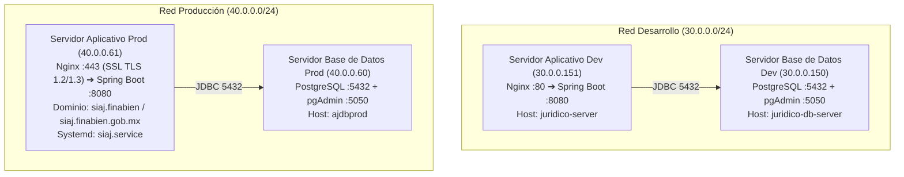
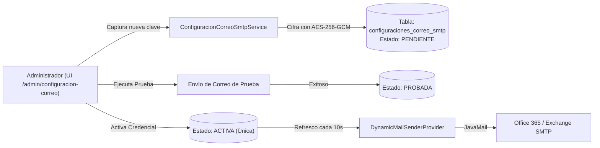

# 🤖 Manual de Operaciones y Arquitectura para Agentes - SIAJ

Este documento consolida la arquitectura técnica, topología de infraestructura, políticas de seguridad, estándares de base de datos, arquitectura de tiempo real y flujos de despliegue del **Sistema Integral de Agenda Jurídica (SIAJ)**. Cualquier agente o ingeniero que opere en este repositorio o en los servidores remotos debe apegarse estrictamente a estas directrices.

---

## 🌐 1. Topología de Infraestructura y Servidores

El sistema opera en dos redes privadas institucionales aisladas (ambientes *air-gapped* sin salida directa a internet):



### Tabla Resumen de Conectividad

| Componente | IP | Host / Dominio | Usuario SSH | Rol / Servicio | Tecnologías Clave |
| :--- | :--- | :--- | :--- | :--- | :--- |
| **BD Desarrollo** | `30.0.0.150` | `juridico-db-server` | `agendajuridicodbdev` | Motor PostgreSQL + pgAdmin | Docker, Postgres latest, Named Volume (`agendajuridicodbdev_postgres_data`) |
| **App Desarrollo** | `30.0.0.151` | `juridico-server` | `agendajuridicoappdev` | Backend Spring Boot + Nginx | Java 17, Nginx (:80), `deploy.sh` / `scripts/deploy-dev.sh` |
| **BD Producción** | `40.0.0.60` | `ajdbprod` | `ajdbprod` | Motor PostgreSQL + pgAdmin | Docker, Postgres 15-alpine, Named Volume (`siaj_postgres_data`) |
| **App Producción** | `40.0.0.61` | `siaj.finabien`<br>`siaj.finabien.gob.mx` | `ajappprod` | Backend Spring Boot + Nginx SSL | Java 17, Nginx (:443 SSL), Systemd `siaj.service` |

### Matriz de Puertos y Enrutamiento

| Puerto | Protocolo | Servicio / Componente | Ámbito de Red | Propósito |
| :--- | :--- | :--- | :--- | :--- |
| **443** | HTTPS / WSS | Nginx (Producción) | Intranet Institucional | Punto de entrada seguro SSL para usuarios finales y WebSockets |
| **80** | HTTP | Nginx (Desarrollo) | Red Interna Dev | Proxy inverso a Spring Boot en ambiente de desarrollo |
| **8080** | HTTP | Spring Boot (Tomcat interno) | Localhost (`127.0.0.1`) | Servidor de aplicaciones Java backend |
| **5432** | TCP / JDBC | PostgreSQL | Redes privadas (30.0.0.0 y 40.0.0.0) | Motor relacional de base de datos |
| **5050** | HTTP | pgAdmin 4 (Docker) | Red privada de BD | Administración gráfica web de PostgreSQL |

---

## 🛡️ 2. Reglas Críticas de Seguridad y Operación (Lectura Obligatoria)

1. **ARCHIVOS TRAMPA / HONEYPOT DE EDR (NO TOCAR BAJO NINGUNA CIRCUNSTANCIA):**
   * En los 4 servidores está instalado el agente de seguridad institucional en `/opt/apps/hisec-endpoint` (Huawei / Sangfor HiSec Endpoint EDR).
   * Existen directorios trampa como `~/Documents/`, `~/.!9m7EmrJj` y `~/.zMq4qsa5T` con archivos señuelo (`Sensitive Contracts`, `Personal Secret`, etc.).
   * **NUNCA modificar, renombrar ni eliminar estos archivos/directorios**, ya que dispararán alertas críticas de ransomware en la consola de ciberseguridad institucional y bloquearán el servidor.

2. **ENTORNO AIR-GAPPED Y PROHIBICIÓN DE CDNS EXTERNOS:**
   * La infraestructura de producción y desarrollo **NO TIENE ACCESO A INTERNET**.
   * **Regla estricta:** Todas las bibliotecas frontend (JS, CSS, fuentes, iconos) deben servirse localmente desde el classpath (`src/main/resources/static/lib/` o `/vendor/`).
   * Queda estrictamente prohibido importar recursos de `cdnjs.cloudflare.com`, `cdn.jsdelivr.net`, `unpkg.com`, `fonts.googleapis.com` o cualquier dominio externo. Fallarán de inmediato en los navegadores de los usuarios institucionales.

3. **COMPORTAMIENTO DE LA CARPETA `~/.vscode-server`:**
   * La extensión *Remote - SSH* de VS Code descarga y arranca automáticamente este agente en el servidor cada vez que un usuario se conecta desde su cliente.
   * No debe intentarse eliminar en bucle mientras exista una sesión remota activa. Para ocultarla en el explorador visual, agregar a `settings.json`: `"files.exclude": { "**/.vscode-server": true }`.

4. **MANEJO DE CONTRASEÑAS CON CARACTERES ESPECIALES (`$` y `#`):**
   * En contraseñas como `DBag3$#38`, bash interpreta `$#` como número de argumentos (`0`), corrompiendo la clave a `DBag3038`.
   * **Regla estricta:** Todas las contraseñas en scripts Bash o archivos `.env` deben ir entre comillas simples: `DB_PASSWORD='DBag3$#38'`.

5. **POLÍTICA DE USUARIOS INSTITUCIONALES DE BASE DE DATOS:**
   * **NUNCA utilizar `villalobos_admin`:** Ese rol quedó completamente deprecado y eliminado del motor de base de datos.
   * En Desarrollo: Superusuario oficial **`agendajuridicodbdev`** (Base: `sistema_juridico`).
   * En Producción: Administrador **`siaj_postgres_admin`**, aplicativo **`siaj_app`** y paridad institucional **`agendajuridicodbdev`** (Base: `siaj`).

6. **INMUTABILIDAD DE HIBERNATE `validate`:**
   * La propiedad `spring.jpa.hibernate.ddl-auto=validate` es obligatoria en todos los entornos compartidos.
   * La aplicación nunca debe crear ni modificar tablas en tiempo de ejecución. Cualquier cambio de esquema debe realizarse mediante migraciones versionadas de Flyway.

7. **MANEJO SEGURO DE SECRETOS Y LLAVES MAESTRAS:**
   * Las llaves de cifrado (`MAIL_CREDENTIAL_ENCRYPTION_KEY`, `JWT_SECRET`, credenciales VAPID y Microsoft Entra) residen exclusivamente en `/etc/siaj/siaj.env` (producción) o en `/opt/siaj/config/.env` (desarrollo), protegidos con permisos `chmod 600`.
   * **Nunca comitear credenciales en texto plano** en el repositorio Git.

---

## 📁 3. Estructura Homogénea en Servidores de Base de Datos

Ambos servidores de BD (`30.0.0.150` y `40.0.0.60`) operan con una estructura de directorios 100% idéntica y simétrica:

```text
/home/<usuario>/
├── installers/                   <--- Imágenes Docker offline (.tar) conservadas para contingencias
│   ├── pgadmin4-latest.tar
│   ├── postgres-15-alpine.tar
│   └── postgres-latest.tar (en Dev)
│
├── siaj/                         <--- Raíz oficial del servicio de Base de Datos
│   ├── docker-compose.yml        <--- Orquestación con volúmenes nombrados (external: true)
│   ├── .env                      <--- Variables de entorno (permisos 600)
│   ├── README.md                 <--- Manual operativo del servidor
│   ├── backups/                  <--- Dumps históricos fechados (.dump / .sql)
│   ├── init/                     <--- Scripts de aprovisionamiento en frío (/docker-entrypoint-initdb.d/)
│   │   └── 00-*.sh
│   └── scripts/
│       └── ops/                  <--- Utilidades operativas (auditoría de grants, reset de admin)
│
└── [Archivos de Sistema y EDR]   <--- .bashrc, .ssh, .!*, .z*, Documents
```

### Gestión de Volúmenes Docker en Base de Datos:
* **Producción (`40.0.0.60`):** Opera con volúmenes gestionados por Docker: `siaj_postgres_data` y `siaj_pgadmin_data`. Ya no existen carpetas con permisos conflictivos de root (`./postgres-data`) en el host.
* **Desarrollo (`30.0.0.150`):** Opera con el volumen `agendajuridicodbdev_postgres_data`.
* **Verificación de Integridad:** Se cuenta con el script de solo lectura [`deploy/database/08-verify-schema.sql`](file:///C:/Users/Rodrigo.DESKTOP-2MLHEH3/.codex/worktrees/siaj-alcance-1-semaforos/juridico-springboot/deploy/database/08-verify-schema.sql) para auditar tablas, columnas, índices, reglas XOR y triggers de tiempo real (`fn_notify_realtime()`).

---

## ⚙️ 4. Estructura y Operación en Servidores de Aplicativo

### Servidor de Producción (`40.0.0.61`):
* **Binario JAR:** `/home/ajappprod/siaj/app/siaj.jar`
* **Servicio Systemd:** `siaj.service`
* **Variables de Entorno:** `/etc/siaj/siaj.env`
* **Configuración Hibernate:** `/home/ajappprod/siaj/config/application.properties` (`spring.jpa.hibernate.ddl-auto=validate`)
* **Certificados SSL:** `/etc/pki/tls/certs/siaj-cert.pem` y `/etc/pki/tls/private/siaj.key` (o `/home/ajappprod/certs/`, permisos carpeta `0700`, llaves `0600`)
* **Nginx:** Proxy inverso en puerto 443 HTTPS hacia `http://127.0.0.1:8080` para `siaj.finabien` y `siaj.finabien.gob.mx`. Incluye soporte nativo para WebSocket:
  ```nginx
  proxy_set_header Upgrade $http_upgrade;
  proxy_set_header Connection "upgrade";
  proxy_connect_timeout 60s;
  proxy_send_timeout 90s;
  proxy_read_timeout 90s;
  ```
* **Reinicio seguro no interactivo:** Para evitar solicitudes interactivas de contraseña `sudo`, `deploy.ps1` envía señal SIGINT (`kill -INT "$old_pid"`) y monitorea el ciclo de vida del servicio hasta que Systemd arranca el nuevo `MainPID`.

### Servidor de Desarrollo (`30.0.0.151`):
* **Binario JAR:** `/opt/siaj/app/sistema-juridico.jar`
* **PID del Proceso:** `/opt/siaj/app/app.pid`
* **Directorio Uploads:** `/opt/siaj/app/uploads/` (con symlink `~/uploads -> /opt/siaj/app/uploads` para paridad con Nginx)
* **Script de Despliegue Remoto:** `/home/agendajuridicoappdev/deploy.sh` (o [`scripts/deploy-dev.sh`](file:///C:/Users/Rodrigo.DESKTOP-2MLHEH3/.codex/worktrees/siaj-alcance-1-semaforos/juridico-springboot/scripts/deploy-dev.sh)), que retiene máximo los 3 últimos JARs, rota `app.log` preventivamente si supera 100 MB y verifica disponibilidad HTTP en `http://localhost:8080/`.
* **Script de Arranque:** `/opt/siaj/app/start.sh`
* **Logs Activos:** `/opt/siaj/logs/app.log` (`tail -f /opt/siaj/logs/app.log`)

---

## 🚀 5. Flujo de Despliegue Automatizado (`deploy.ps1`)

El proyecto se despliega localmente utilizando el pipeline en PowerShell [`deploy.ps1`](file:///C:/Users/Rodrigo.DESKTOP-2MLHEH3/.codex/worktrees/siaj-alcance-1-semaforos/juridico-springboot/deploy.ps1):

### Sintaxis y Opciones Disponibles:

```powershell
# 1. Despliegue estándar a Desarrollo (compila con Maven y transfiere vía SCP a 30.0.0.151)
.\deploy.ps1 -Env dev

# 2. Despliegue a Producción (solicita confirmación interactiva, respalda JAR y reinicia siaj.service en 40.0.0.61)
.\deploy.ps1 -Env prod

# 3. Despliegue especificando una rama git concreta (realiza checkout y pull antes de compilar)
.\deploy.ps1 -Env dev -Branch develop
.\deploy.ps1 -Env prod -Branch release/siaj-2.0-integracion-final

# 4. Despliegue rápido sin recompilar (reutiliza el último JAR generado en target/)
.\deploy.ps1 -Env dev -SkipBuild

# 5. Despliegue a Producción desatendido / sin confirmación manual
.\deploy.ps1 -Env prod -Force
```

### Características Operativas del Pipeline:
* **Liberación de locks en Windows:** Detecta y finaliza automáticamente procesos `java.exe` locales que retengan el archivo JAR compilado antes de empaquetar.
* **Compilación:** Ejecuta `.\mvnw.cmd clean package -DskipTests`.
* **Transferencia:** Utiliza `scp -o BatchMode=yes` para transferencias desatendidas.
* **Respaldo Automático:** Genera copias de seguridad con timestamp (`siaj.jar.bak-YYYYMMDD-HHMMSS`) en el servidor antes de sobreescribir el binario.

---

## 🗺️ 6. Arquitectura de Base de Datos y Migraciones Flyway

El sistema utiliza **Flyway** como única fuente de verdad para la evolución de la base de datos, en conjunto con Hibernate en modo estricto de validación (`spring.jpa.hibernate.ddl-auto=validate`).

### Estructura de Migraciones (`src/main/resources/db/migration/`)

1. **`V1__baseline_siaj.sql`:**
   - Baseline de esquema DDL completo (54 tablas, secuencias, claves foráneas e índices).
   - Define el modelo completo de expedientes, asuntos independientes, términos, audiencias, documentos, carpetas, alertas y suspensiones.
   - Restricción XOR de exclusividad en origen:
     ```sql
     CONSTRAINT ck_audiencias_origen_exclusivo CHECK ((expediente_id IS NOT NULL) <> (asunto_independiente_id IS NOT NULL))
     CONSTRAINT ck_terminos_origen_exclusivo CHECK ((expediente_id IS NOT NULL) <> (asunto_independiente_id IS NOT NULL))
     ```
2. **`V2__catalogo_datos_iniciales.sql`:**
   - Carga idempotente de perfiles de alerta y recordatorios predeterminados (`PLAZO_CORTO`, `PLAZO_MEDIO`, `PLAZO_VARIABLE_ESTANDAR`, `AUDIENCIA_ESTANDAR`) con cláusulas `ON CONFLICT (codigo, version) DO NOTHING`.
3. **Reglas para Futuras Migraciones (`V3__...`, `V4__...`):**
   * **Inmutabilidad Absoluta:** NUNCA editar una migración ya aplicada (`V1`, `V2`). Flyway valida los checksums en el arranque; si un archivo existente cambia, la aplicación fallará.
   * **Nomenclatura:** Prefijo `V<Número>__<descripcion_con_guiones_bajos>.sql` con doble guion bajo.
   * **Idempotencia:** Utilizar siempre `IF NOT EXISTS` en `CREATE TABLE`/`ADD COLUMN` y `ON CONFLICT DO NOTHING` en `INSERT`.
   * **Paridad de Entidades JPA:** Cualquier nueva columna o tipo de dato debe reflejarse fielmente en la entidad `@Entity` Java correspondiente, respetando nombres, nulabilidad y tipos SQL.

### Desacoplamiento de DDL en el Arranque Java
* `DatabaseSchemaCompatibilityInitializer`: Deshabilitado por defecto mediante `@ConditionalOnProperty(name = "app.legacy-schema-compatibility.enabled", havingValue = "true")`.
* `AtencionTemporalInitializer`: Deshabilitado por defecto mediante `@ConditionalOnProperty(name = "app.seed.temporal-atencion.enabled", havingValue = "true")`.

### Normalización Centralizada de Códigos (`VARCHAR(50)`)
* Toda entidad con campos de código institucional (como `TipoAudiencia` y `TipoTermino`) implementa [`com.juridico.sistema_juridico.util.CodigoNormalizer`](file:///C:/Users/Rodrigo.DESKTOP-2MLHEH3/.codex/worktrees/siaj-alcance-1-semaforos/juridico-springboot/src/main/java/com/juridico/sistema_juridico/util/CodigoNormalizer.java):
  * Descomposición NFD (`\p{M}`) para remover acentos y caracteres especiales.
  * Límite estricto $\le 50$ caracteres:
    - Con sufijo ID: trunca la base a `(49 - len(id))` y añade `_<id>`.
    - Sin sufijo ID: si excede 50 caracteres, trunca a 41 y añade hash SHA-256 corto de 8 caracteres (`_<hash>`).
  * Respaldado por suite de pruebas exhaustiva en `CodigoNormalizerTest`.

---

## 🔔 7. Arquitectura de Tiempo Real (WebSocket y Web Push)

### WebSocket / STOMP Hub Centralizado
* **Cliente Unificado:** Todo el frontend interactúa a través de `window.WebSocketManager`, instanciado globalmente en [`src/main/resources/templates/fragments/navbar.html`](file:///C:/Users/Rodrigo.DESKTOP-2MLHEH3/.codex/worktrees/siaj-alcance-1-semaforos/juridico-springboot/src/main/resources/templates/fragments/navbar.html).
* **Bibliotecas Locales Offline:** Las dependencias [`sockjs.min.js`](file:///C:/Users/Rodrigo.DESKTOP-2MLHEH3/.codex/worktrees/siaj-alcance-1-semaforos/juridico-springboot/src/main/resources/static/lib/sockjs.min.js) y [`stomp.min.js`](file:///C:/Users/Rodrigo.DESKTOP-2MLHEH3/.codex/worktrees/siaj-alcance-1-semaforos/juridico-springboot/src/main/resources/static/lib/stomp.min.js) residen localmente en `src/main/resources/static/lib/` para operar sin conexión exterior.
* **Heartbeats de Conexión:** STOMP está configurado con latidos bidireccionales de 10 segundos (`incoming: 10000`, `outgoing: 10000`) para evitar que Nginx cierre las conexiones inactivas.
* **Tópicos Estándar:**
  - `/topic/alertas`: Alertas generales de términos y audiencias.
  - `/topic/expedientes`: Cambios de estado y asignaciones de expedientes.
  - `/topic/catalogos`: Actualización de catálogos institucionales.
  - `/topic/terminos/locks`: Bloqueos concurrentes en captura de plazos.
  - `/user/queue/alertas`: Notificaciones dirigidas exclusivamente al usuario autenticado.

### Notificaciones Web Push (VAPID)
* **Configuración:** Activada mediante variables de entorno `VAPID_PUBLIC_KEY`, `VAPID_PRIVATE_KEY` y `VAPID_SUBJECT` (`app.webpush.*`).
* **Frontend:** Administrado por [`src/main/resources/static/js/webpush-client.js`](file:///C:/Users/Rodrigo.DESKTOP-2MLHEH3/.codex/worktrees/siaj-alcance-1-semaforos/juridico-springboot/src/main/resources/static/js/webpush-client.js) y la vista de perfil de usuario (`templates/fragments/perfil/notificaciones.html`).
* **Suscripción Segura:** Almacena las llaves públicas de suscripción de navegador en `preferencias_notificacion` con validación y sanitización de mensajes.

---

## 📧 8. Módulo Dinámico de Correo SMTP (Cifrado AES-256-GCM)

SIAJ cuenta con un motor dinámico de configuración de contraseñas de correo para permitir rotaciones periódicas sin reiniciar el servidor:



### Directrices Operativas del Servicio de Correo:
1. **Llave Maestra Externa:** La variable `MAIL_CREDENTIAL_ENCRYPTION_KEY` debe definirse en `/etc/siaj/siaj.env` (clave aleatoria de 32 bytes en Base64 generada con `openssl rand -base64 32`). Nunca se almacena en la base de datos ni en el código.
2. **Refresco en Memoria:** `DynamicMailSenderProvider` sondea la base de datos cada 10 segundos (`MAIL_DYNAMIC_REFRESH_MS=10000`). En el nodo que activa el cambio, la invalidación es inmediata.
3. **Respaldo y Continuidad:** Si no existe ninguna credencial en estado `ACTIVA` en la base de datos, el sistema utiliza de forma transparente las propiedades tradicionales `spring.mail.*` de `application.properties`.
4. **Optimización para Office 365 / Exchange:**
   - `spring.mail.properties.mail.smtp.quitwait=false` (evita bloqueos en el cierre de sesión SMTP).
   - Timeouts optimizados: conexión 10s, lectura 25s, escritura 15s.
   - Correos de restablecimiento con formato MIME `multipart/alternative` (soporta clientes de correo corporativos que requieren versiones texto y HTML sincronizadas).

---

## 🔐 9. Autenticación y Microsoft Entra ID (SSO)

SIAJ implementa un esquema dual de autenticación:

1. **Autenticación Local (Predeterminada):**
   * Control de sesiones con Spring Security y tokens JWT para endpoints protegidos (`app.jwt.secret`, expiración 1 hora).
   * Recuperación de contraseña por correo electrónico con token de un solo uso (`PASSWORD_RESET_BASE_URL=https://siaj.finabien`).
   * Protección contra fuerza bruta y rate limiting integrado por usuario (máximo 5 solicitudes/hora) y por dirección IP (máximo 10 solicitudes/hora).

2. **Autenticación Federada Microsoft Entra ID (Azure AD):**
   * Integración mediante protocolo OAuth2 / OpenID Connect con Microsoft Graph API.
   * **Variables de Entorno:**
     - `MICROSOFT_LOGIN_ENABLED=true` / `MICROSOFT_LOGIN_UI_VISIBLE=true`
     - `MICROSOFT_TENANT_ID=<tenant-uuid>`
     - `MICROSOFT_CLIENT_ID=<app-registration-id>`
     - `MICROSOFT_CLIENT_SECRET=<client-secret>`
     - `MICROSOFT_REDIRECT_URI=https://siaj.finabien/auth/microsoft/callback`

---

## 🧪 10. Flujo de Trabajo Local, Pruebas y Diagnóstico Operativo

### Entorno de Desarrollo Local
* **JDK:** Java 17 o 21 (LTS).
* **Compilación sin pruebas (Rápido):**
  ```powershell
  .\mvnw.cmd clean package -DskipTests
  ```
* **Ejecución de la Suite Completa de Pruebas:**
  ```powershell
  .\mvnw.cmd test
  ```
  *(El entorno de pruebas utiliza base de datos en memoria H2 con dialecto compatible y Flyway deshabilitado para pruebas unitarias instantáneas).*

* **Ejecutar Localmente en Desarrollo:**
  ```powershell
  .\mvnw.cmd spring-boot:run
  ```

### Pruebas de Calidad Automatizadas (QA Scripts)
En el directorio [`scripts/`](file:///C:/Users/Rodrigo.DESKTOP-2MLHEH3/.codex/worktrees/siaj-alcance-1-semaforos/juridico-springboot/scripts) se encuentran utilidades de smoke test y verificación de regresión:
* `qa-page-smoke.js`: Smoke test de carga de vistas principales.
* `qa-role-smoke.js`: Validación de permisos por rol institucional.
* `qa-scope-check.js`: Verificación de aislamiento de expedientes y asuntos independientes.
* `qa-tareas-crud.js`: Verificación de flujos CRUD en tareas y términos.

### Comandos de Diagnóstico Remoto por SSH

```bash
# Ver estado del servicio en Producción
ssh ajappprod@40.0.0.61 "systemctl status siaj --no-pager"

# Ver logs en vivo en Producción
ssh ajappprod@40.0.0.61 "journalctl -u siaj -f -n 100"

# Ver logs en vivo en Desarrollo
ssh agendajuridicoappdev@30.0.0.151 "tail -f /opt/siaj/logs/app.log"

# Auditar esquema en Base de Datos de Desarrollo
ssh agendajuridicodbdev@30.0.0.150 "docker exec -i siaj-postgres psql -U agendajuridicodbdev -d sistema_juridico" < deploy/database/08-verify-schema.sql

# Auditar esquema en Base de Datos de Producción
ssh ajdbprod@40.0.0.60 "docker exec -i siaj-postgres psql -U siaj_postgres_admin -d siaj" < deploy/database/08-verify-schema.sql
```
