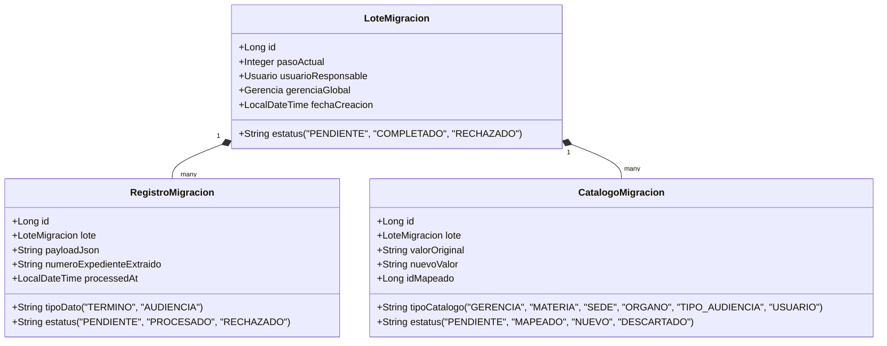
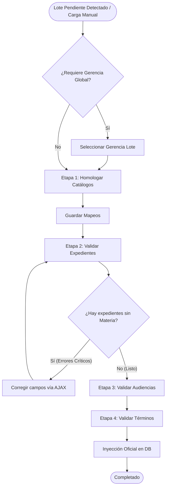

# Documentación Técnica: Apartado de Migración Inteligente (ETL)

El **Apartado de Migración Inteligente** es un subsistema diseñado bajo el patrón **ETL (Extract, Transform, Load)** que permite la importación segura y controlada de expedientes, audiencias y términos provenientes de fuentes externas (como flujos automatizados de n8n o cargas masivas de datos). 

Su objetivo principal es garantizar que la información importada se homologue correctamente con los catálogos del sistema oficial (gerencias, materias, juzgados, estados, etc.) y se limpie de inconsistencias antes de inyectarse formalmente en la base de datos.

---

## 1. Arquitectura y Modelo de Datos

La migración opera sobre un modelo intermedio desacoplado de las tablas oficiales del sistema. Esto permite revisar, editar y validar los datos sin contaminar los expedientes reales en producción.



---

## 2. API de Integración (Entrada de Datos)

El controlador `MigrationApiController` (`/api/migration`) provee puntos de entrada para la ingesta externa. Estas llamadas alimentan el lote de migración activo o crean uno nuevo en caso de no existir ninguno pendiente.

### Seguridad y Encabezados (Headers)

Todas las llamadas de integración requieren el siguiente encabezado para autenticación:

| Encabezado | Valor / Descripción |
| :--- | :--- |
| `X-API-KEY` | `n8nAgendaLegalF1N4813NGDSA6D54` |
| `Content-Type` | `application/json` |

### Endpoints Disponibles

#### 1. Ingesta de Término Individual
* **URL:** `POST /api/migration/terminos`
* **Cuerpo (JSON):**
  ```json
  {
    "numeroExpediente": "123/2024",
    "materia": "Civil",
    "gerencia": "Gerencia Civil, Mercantil, Fiscal y Administrativo",
    "abogadoResponsable": "Lic. Juan Pérez",
    "asunto": "Presentación de Demanda",
    "fechaVencimiento": "2026-06-15",
    "prioridad": "Alta",
    "observaciones": "Comentarios adicionales..."
  }
  ```

#### 2. Ingesta de Audiencia Individual
* **URL:** `POST /api/migration/audiencias`
* **Cuerpo (JSON):**
  ```json
  {
    "numeroExpediente": "123/2024",
    "materia": "Civil",
    "gerencia": "Gerencia Civil, Mercantil, Fiscal y Administrativo",
    "tipoAudiencia": "Constitucional",
    "fechaAudiencia": "2026-06-20",
    "horaAudiencia": "10:30:00",
    "abogadoCompareciente": "Lic. Juan Pérez",
    "esEnLinea": "true",
    "enlaceReunion": "https://teams.microsoft.com/..."
  }
  ```

#### 3. Ingesta por Lotes (Batch)
Permiten recibir listas de elementos de manera eficiente optimizando la persistencia mediante consultas por lotes.
* **Términos:** `POST /api/migration/lote/terminos`
* **Audiencias:** `POST /api/migration/lote/audiencias`
* **Cuerpo (JSON):** Acepta tanto un objeto JSON simple (individual) como un arreglo (`Array`) de objetos JSON.
* **Deduplicación:** El backend realiza una verificación en memoria $O(1)$ para evitar el registro de duplicados exactos dentro del mismo lote.

---

## 3. Flujo y Normalización Externa (n8n)

El sistema recibe la información pre-procesada desde un flujo automatizado en **n8n**. Este flujo extrae los datos desde múltiples hojas de cálculo de Google Sheets (tanto históricas como activas), los normaliza a un formato estándar y los envía en lotes al sistema oficial.

A continuación se detalla el funcionamiento y la lógica de cada nodo en el flujo:

### A. Inicialización y Selección de Hojas
* **Trigger Manual (`When clicking ‘Execute workflow’`):** Punto de inicio manual para disparar la ejecución del flujo.
* **`Configurar Listas de Hojas1` (Código JS):** 
  * Inicializa el almacenamiento temporal global (`globalData.allRecords = []`).
  * Define las URLs de los documentos de Google Sheets a leer:
    * `url_nuevo`: Documento con hojas activas (`AGENDA TÉRMINOS`, `AGENDA DE AUDIENCIAS`).
    * `url_viejo`: Documento con el histórico de meses pasados (de Noviembre a Mayo).
  * Retorna una lista con la especificación de cada hoja, su URL de origen y su tipo de dato (`TÉRMINOS` o `AUDIENCIAS`).
  * Nota: para extraer datos de un nuevo documento se debe configurar este nodo agregando las hojas que contiene ese documento y cargar su url del archivo

### B. Ciclo de Lectura Dinámica
* **`Loop Multidocumento5` (Split in Batches):** Itera sobre la lista de hojas configuradas.
* **`Leer Hojas Dinámicas5` (Google Sheets):** Consulta el rango `A1:ZZ` de la hoja activa en el ciclo. Está configurado para continuar en caso de error (`onError = continueErrorOutput`) y realizar hasta 5 reintentos con 500ms de intervalo en caso de fallo temporal.
* **`Wait10` (Wait):** Añade un retraso de 3 segundos entre iteraciones para respetar el límite de cuota (Rate Limit) de la API de Google Sheets.

### C. Normalización y Acumulación (`Normalizar y Acumular11` - Código JS)
Procesa cada fila de datos de la hoja actual y realiza la homologación preliminar:
1. **Mapeo Dinámico de Cabeceras:** Identifica la fila que contiene las cabeceras buscando palabras clave (`EXPEDIENTE`, `PARTES`, `TRIBUNAL`, etc.). Esto permite mapear correctamente las columnas aun si tienen saltos de línea o ligeras variaciones de nombre.
2. **Normalización de Expedientes:** Limpia el número. Valores como `S/N`, `N/A`, `SIN NUMERO` o `PENDIENTE` se estandarizan a `S/N`. Los años abreviados a dos dígitos se completan a cuatro (ej. `24` $\rightarrow$ `2024`).
3. **Normalización de Fechas:** Analiza las fechas en texto en español (ej. "de Enero de", "may", "abr") y las convierte al estándar ISO `YYYY-MM-DD`.
4. **Normalización de Horas:** Limpia la cadena de hora y la convierte al formato militar de 24 horas (`HH:mm`), resolviendo indicaciones AM/PM.
5. **Formateo de Texto:** Convierte nombres de partes, abogados, juzgados y tipos de audiencias a formato de título (*Title Case*), respetando preposiciones en minúscula y siglas conocidas en mayúscula (ej. `CDMX`, `TFCA`).
6. **Lógica de Acuses y Observaciones:**
   * Si el acuse contiene una URL (Drive/SharePoint), se extrae y guarda en el campo `acuse`/`actaDocumento`.
   * Si contiene texto plano sin enlaces, se mueve a `observaciones` y el acuse queda como `"Sin acuse"`.
   * Si está vacío, se marca como `"Pendiente"` si la fecha es futura/hoy, o como `"Sin acuse"` si la fecha ya pasó.
7. **Clasificación del Periodo:** Genera etiquetas descriptivas (ej. `TÉRMINOS MAYO 2026`) y un identificador numérico de ordenamiento (`sortKey`, ej. `202605`) basados en la fecha o el nombre de la hoja.
8. **Acumulación:** Agrega los registros limpios en el arreglo global `globalData.allRecords`.

### D. División y Envío por Lotes (Batching)
Una vez concluido el ciclo de lectura de todas las hojas:
* **`Extraer Audiencias3` y `Extraer Términos3` (Código JS):** Filtran y separan el arreglo `globalData.allRecords` según su tipo, extrayendo los objetos JSON limpios.
* **`Lotes Audiencias1` y `Lotes Términos1` (Split in Batches):** Dividen la lista de registros normalizados en subgrupos de máximo **100 elementos**.
* **`HTTP Request10` y `HTTP Request11`:** Envían mediante peticiones `POST` concurrentes los lotes de datos a `/api/migration/lote/audiencias` y `/api/migration/lote/terminos` incluyendo los encabezados de autenticación (`X-API-KEY`).

---

## 4. El Flujo de Trabajo ETL (Wizard de la UI)

El administrador interactúa con la migración en `/admin/importar`. El flujo progresa a través de cuatro etapas interactivas.



---

### Etapa 1: Homologación de Catálogos (Mapeo)
Durante esta etapa, el sistema extrae todos los textos crudos de las columnas de metadatos de los payloads JSON (`RegistroMigracion`) y los consolida en entidades `CatalogoMigracion`.

#### Catálogos Homologados:
1. **GERENCIA** (Estructura jerárquica primaria)
2. **MATERIA**
3. **SEDE** (Entidades federativas)
4. **ORGANO** (Juzgados/Salas)
5. **TIPO_AUDIENCIA**
6. **USUARIO** (Abogados internos)

#### Acciones del Administrador en UI:
* **Mapeo Existente:** Seleccionar mediante un dropdown (`TomSelect`) el elemento correspondiente en la base de datos oficial.
* **Crear como Nuevo (Icono `+`):** Indica al sistema que cree este elemento durante la inyección. Se habilita un botón de edición (icono lápiz) que permite corregir la ortografía o renombrar el valor antes de crearlo.
* **Descartar (Icono `-`):** Omite la importación de cualquier registro asociado a este valor específico.
* **Auto-Mapeo Inteligente:** El sistema normaliza los textos (elimina acentos, mayúsculas y espacios múltiples) e intenta asociar automáticamente los elementos con los registros existentes de la base de datos.
* **Cascada de Actualización:** Al enviar esta etapa, los valores mapeados o renombrados se reescriben directamente en los payloads JSON de los registros.

---

### Etapa 2: Validación de Expedientes
Los registros individuales se agrupan en memoria bajo un Expediente virtual unificado.

#### Reglas de Agrupación:
* **Expedientes con Número:** Se agrupan bajo el número extraído del JSON.
* **Expedientes sin Número ("S/N" o similares):** El sistema calcula un Hash consistente en base a los campos `partes`, `materia` y `organoJurisdiccional` para agrupar las audiencias y términos que pertenecen al mismo caso anónimo.

#### Comportamiento de validación:
* El sistema comprueba si el expediente ya existe en la base de datos oficial.
* Si el expediente ya existe, se utilizan sus datos reales de la base de datos como fuente de verdad, ignorando los del payload para no sobrescribir información correcta en producción.
* Si es nuevo, hereda y consolida datos basándose en el registro más reciente.
* **Validaciones Críticas (Bloqueantes para avanzar):** Se impide el progreso a la Etapa 3 si existen expedientes que carezcan de **Materia** o **Gerencia**.
* **Asignación Automática por Defecto:** Si el expediente nuevo carece de materia, se le asigna automáticamente según su gerencia:
  * *"Laboral"* para Gerencias Laboral/Penal.
  * *"Administrativo"* para Gerencias Civil/Mercantil/Fiscal/Administrativo.

---

### Etapa 3: Validación de Audiencias
Se listan todas las audiencias extraídas del lote agrupadas por expediente.

* Se resuelven y pre-cargan los IDs mapeados de los catálogos (Abogado Compareciente, Abogado Responsable, Sede, Órgano, Tipo de Audiencia).
* Permite definir si la audiencia es en línea (`esVirtual` / `esEnLinea`) y gestionar los enlaces URL de las reuniones de forma dinámica.
* Edición inline de datos de fecha, hora, sala y comentarios.

---

### Etapa 4: Validación de Términos
Se revisan los plazos procesales del lote.

* Atributos gestionados: Actuación, Fecha de Vencimiento, Fecha de Ingresos, Abogado Responsable, Prioridad (Alta, Media, Baja), Acuse de Recibo (Word/PDF).
* El estatus del término se infiere automáticamente: si la fecha de vencimiento ya pasó, se crea como `CONCLUIDO`; de lo contrario, se inicializa en etapa `PROYECTISTA`.

---

## 5. Inyección Final a la Base de Datos Oficial

Al presionar "Inyectar", la ejecución de `inyectarLoteOficial` inicia el proceso de carga:

1. **Creación de Catálogos:** Se crean en la base de datos oficial todas las entidades de materias, órganos, tipos de audiencias o usuarios que el administrador marcó como **NUEVO**.
2. **Estrategia Transaccional por Expediente:** Para evitar que un error aislado cancele la migración de miles de registros, la inyección procesa cada grupo de expediente bajo su propia transacción independiente (`@Transactional(propagation = Propagation.REQUIRES_NEW)`).
3. **Deduplicación en Persistencia:**
   * **Términos:** Se omiten si coincide el Expediente, la Actuación/Asunto y la Fecha de Vencimiento.
   * **Audiencias:** Se omiten si coincide el Expediente, la Fecha de Audiencia y la Hora.
4. **Limpieza Final:** Al finalizar de forma exitosa, el lote cambia su estatus a `COMPLETADO` (Paso 5) y cancela automáticamente otros lotes concurrentes en estado `PENDIENTE` para garantizar la consistencia en la pantalla de inicio del administrador.

---

## 6. Endpoints de la Interfaz Web (Admin)

Todos estos endpoints se acceden bajo el prefijo `/admin/importar`:

### Navegación y Procesamiento de Pasos

| Endpoint | Método | Parámetros | Descripción |
| :--- | :--- | :--- | :--- |
| `/` | `GET` | Ninguno | Muestra el asistente en su paso actual o la pantalla de espera. |
| `/iniciar` | `POST` | Ninguno | Inicia manualmente un lote de prueba vacío. |
| `/guardar-gerencia-global` | `POST` | `loteId`, `gerenciaId` | Asigna una gerencia general a un lote que carece de materias. |
| `/mapear-catalogos` | `POST` | `loteId`, `Map<String, String>` | Persiste los mapeos homologados en la Etapa 1. |
| `/validar-expedientes` | `POST` | `loteId` | Valida la consistencia de los expedientes y avanza a Etapa 3. |
| `/validar-audiencias` | `POST` | `loteId` | Finaliza la revisión de audiencias y avanza a Etapa 4. |
| `/inyectar` | `POST` | `loteId` | Ejecuta la persistencia final de datos en la base de datos oficial. |
| `/cancelar` | `POST` | `loteId` | Cancela el lote de migración y rechaza los registros pendientes. |
| `/corregir-materias` | `POST` | Ninguno | Utilería manual post-migración que asigna materias por defecto según la gerencia. |

### Endpoints Internos de API AJAX (Control dinámico)

| Endpoint | Método | Parámetros | Descripción |
| :--- | :--- | :--- | :--- |
| `/editar-registro` | `POST` | `registroId`, `Map<String, String>` | Guarda las ediciones inline hechas desde los modales en Etapas 2, 3 y 4. |
| `/api/actualizar-catalogo-texto` | `POST` | `catId`, `nuevoTexto` | Guarda el texto renombrado de un elemento de catálogo en la Etapa 1. |
| `/api/estado-lote` | `GET` | Ninguno | Retorna si hay un lote activo (polling de pantalla de inicio). |
| `/api/buscar-expedientes-similares`| `GET` | `term`, `loteId` | Autocompleta números de expediente similares en el sistema. |
| `/api/todos-abogados` | `GET` | `loteId` (opcional) | Lista todos los abogados (DB y nuevos del lote) con sus materias. |
| `/api/asignar-materia-abogado` | `POST` | `abogadoId`, `materiaId` | Asocia una materia a un abogado directamente desde la migración. |
| `/api/materias-por-gerencia/{id}` | `GET` | Ninguno | Retorna materias filtradas por gerencia (cascada de selects). |
| `/api/usuarios-por-gerencia/{id}` | `GET` | Ninguno | Retorna usuarios/abogados filtrados por gerencia. |
| `/api/organos-por-gerencia/{id}` | `GET` | Ninguno | Retorna juzgados filtrados por gerencia. |
| `/api/tipos-audiencia-por-gerencia/{id}`| `GET`| Ninguno | Retorna tipos de audiencia filtrados por gerencia. |

# Anexos
* docker-compose.yml
version: '3.8'

services:
  n8n:
    image: n8nio/n8n:latest
    container_name: n8n_local
    restart: always
    ports:
      - "5678:5678"
    environment:
      - N8N_HOST=localhost
      - TZ=America/Mexico_City
      - USER_ID=1000
      - GROUP_ID=1000
      - NODE_EXTRA_CA_CERTS=/home/node/custom-ca.crt
      # --- LÍNEAS PARA ACTIVAR MCP ---
      - N8N_BLOCK_MCP_ACCESS=false
      - N8N_PROTOCOL_MCP_ENABLED=true
      - N8N_FEATURE_FLAGS=mcpEnabled,mcpExperimental
      - N8N_DIAGNOSTICS_ENABLED=true
      # -------------------------------
    volumes:
      - /home/servicio-social/.n8n/n8n_data:/home/node/.n8n
      - /home/servicio-social/n8n_date/mis_documentos:/home/node/.n8n-files
      - /home/servicio-social/finabien.crt:/home/node/custom-ca.crt:ro
    depends_on:
      - postgres
    networks:
      - n8n_network

  postgres:
    image: postgres:15
    container_name: postgres_local
    restart: always
    environment:
      - POSTGRES_DB=mi_base
      - POSTGRES_USER=mi_usuario
      - POSTGRES_PASSWORD=mi_password    
    volumes:
      - pg_data:/var/lib/postgresql/data
    networks:
      - n8n_network

  pgadmin:
    image: dpage/pgadmin4
    container_name: pgadmin_local
    restart: always
    environment:
      - PGADMIN_DEFAULT_EMAIL=admin@admin.com
      - PGADMIN_DEFAULT_PASSWORD=admin123
    ports:
      - "5050:80"
    depends_on:
      - postgres
    networks:
      - n8n_network

volumes:
  pg_data:

networks:
  n8n_network:
    driver: bridge