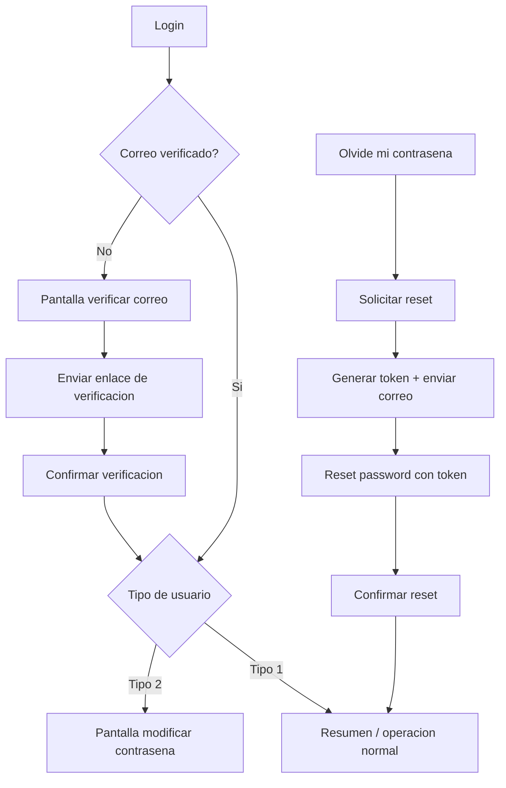

# Manual Tecnico De Implementacion

## Cambio Y Recuperacion De Contrasena En SICGES

Fecha: 2026-06-16  
Proyecto: SICGES (Spring Boot)

---

## 1. Objetivo Del Manual

Este manual documenta, de forma practica y completa, como se implemento en SICGES la funcionalidad de:

1. Recuperacion de contrasena por correo.
2. Cambio forzado de contrasena cuando el sistema lo exige.
3. Verificacion de correo como prerequisito de seguridad.
4. Auditoria de todos los eventos de seguridad relacionados.

La idea es que otra persona pueda tomar este documento y replicar la funcionalidad desde cero, sin adivinar pasos.

---

## 2. Contexto Real De Implementacion (Cronologia)

La implementacion no salio en una sola pasada. Se fue ajustando por etapas:

1. Commit base (alta funcional): `6ef7526` (2026-05-19)  
   Mensaje: *Nueva funcion de correo*.

2. Ajustes de validaciones: `900db78` (2026-05-20)  
   Mensaje: *Validaciones a la nueva funcion*.

3. Ajustes por rutas/contexto para que funcionara en despliegues con prefijo: `989c915` (2026-05-27)  
   Mensaje: *Se tuvo que mover muchas cosas...*.

4. Ajustes de SMTP y endurecimiento: `088cdaf` (2026-06-02)  
   Mensaje: *Se restablece las funciones de SMTP y se validan algunas cosas extras*.

5. Base previa de seguridad en usuario (expiracion, intentos, bloqueo): `e10a57c` (2025-10-28).

Esto es importante porque explica por que hay partes de la solucion en commits de 2025 y otras en 2026.

---

## 3. Vista General Del Flujo

En SICGES quedaron 3 flujos conectados:

1. Flujo A - Login normal con verificacion de correo.
2. Flujo B - Recuperacion de contrasena por enlace enviado al correo.
3. Flujo C - Cambio forzado de contrasena por seguridad (usuario tipo 2 / vencimiento).



---

## 4. Implementacion Desde Cero (Paso A Paso)

## 4.1 Paso 1 - Dependencias en POM

Primero se habilito lo necesario para correo, cifrado de password y vistas HTML.

Dependencias clave en `pom.xml`:

```xml
<dependency>
	<groupId>org.springframework.boot</groupId>
	<artifactId>spring-boot-starter-mail</artifactId>
</dependency>

<dependency>
	<groupId>org.springframework.security</groupId>
	<artifactId>spring-security-crypto</artifactId>
</dependency>

<dependency>
	<groupId>org.springframework.boot</groupId>
	<artifactId>spring-boot-starter-thymeleaf</artifactId>
</dependency>
```

Notas:

1. Mail se usa para envio de reset y confirmacion.
2. Security crypto se usa para `PasswordEncoder` (BCrypt).
3. Thymeleaf se usa para vistas de auth (`/auth/*`).

---

## 4.2 Paso 2 - Configuracion de propiedades

En `application.properties` se agregaron propiedades de negocio para reset/verificacion y SMTP.

Ejemplo de configuracion (recomendada para replicar):

```properties
app.password-reset.expiration-minutes=30
app.password-reset.base-url=https://tu-dominio/contexto
app.email-verification.base-url=https://tu-dominio/contexto

app.password-reset.rate-limit.user-max-requests=5
app.password-reset.rate-limit.user-window-minutes=60
app.password-reset.rate-limit.ip-max-requests=10
app.password-reset.rate-limit.ip-window-minutes=60

spring.mail.host=smtp.outlook.com
spring.mail.port=587
spring.mail.username=usuario@dominio
spring.mail.password=SECRETO

app.email.from=usuario@dominio
app.email.app-name=SICGES
```

Punto fino importante:

1. `base-url` debe apuntar al contexto real del sistema.
2. El codigo ya recorta slash final para evitar URLs rotas.

---

## 4.3 Paso 3 - Base de datos (estructura)

### 4.3.1 One-shot de reset

Archivo: `one-shot/11_SICGES_auth_password_reset_one_shot.sql`

Crea:

1. `sg_usuario_contacto` (correo por usuario).
2. `sg_password_reset_token` (token temporal de recuperacion).
3. Funcion de limpieza de tokens expirados.

Fragmento representativo:

```sql
CREATE TABLE IF NOT EXISTS sg_password_reset_token (
	prt_id BIGSERIAL PRIMARY KEY,
	prt_token VARCHAR(120) NOT NULL,
	prt_usu_id INTEGER NOT NULL,
	prt_correo VARCHAR(254) NOT NULL,
	prt_fec_creacion TIMESTAMP WITHOUT TIME ZONE NOT NULL DEFAULT NOW(),
	prt_fec_expiracion TIMESTAMP WITHOUT TIME ZONE NOT NULL,
	prt_usado BOOLEAN NOT NULL DEFAULT FALSE,
	prt_situacion INTEGER NOT NULL DEFAULT 1
);

CREATE UNIQUE INDEX IF NOT EXISTS ux_sg_password_reset_token_token
	ON sg_password_reset_token (prt_token);
```

### 4.3.2 One-shot de verificacion de correo

Archivo: `one-shot/12_SICGES_auth_email_verification_one_shot.sql`

Agrega columnas a `sg_usuario_contacto`:

```sql
ALTER TABLE sg_usuario_contacto
ADD COLUMN IF NOT EXISTS uco_verificado BOOLEAN NOT NULL DEFAULT FALSE,
ADD COLUMN IF NOT EXISTS uco_codigo_verificacion VARCHAR(12),
ADD COLUMN IF NOT EXISTS uco_fec_codigo_expiracion TIMESTAMP WITHOUT TIME ZONE,
ADD COLUMN IF NOT EXISTS uco_fec_verificacion TIMESTAMP WITHOUT TIME ZONE;
```

### 4.3.3 One-shot de catalogo de auditoria

Archivo: `one-shot/13_SICGES_ctg_auditoria_acciones_seguridad_one_shot.sql`

Registra acciones 11-19 para:

1. Solicitud reset.
2. Token invalido/expirado.
3. Reset confirmado.
4. Rate limit.
5. Error de correo.
6. Envio y confirmacion de verificacion de correo.
7. Omitir verificacion.

### 4.3.4 Migracion de seguridad del usuario

Archivo: `src/main/resources/db/migration/V1_4__add_security_fields.sql`

Agrega en `sg_usuario`:

1. `usu_failed_attempts`.
2. `usu_account_locked`.
3. `usu_last_password_change`.

Con esto se soporta bloqueo por intentos y expiracion de contrasena.

---

## 4.4 Paso 4 - Capa de modelo y repositorio

### 4.4.1 Entidad de token

Archivo: `src/main/java/com/example/gestionBasica/models/PasswordResetToken.java`

Mapea tabla `sg_password_reset_token` con campos como:

1. token.
2. usuarioId.
3. fechaExpiracion.
4. usado.
5. situacion.

### 4.4.2 Repositorio de token

Archivo: `src/main/java/com/example/gestionBasica/repositories/PasswordResetTokenRepository.java`

Consultas clave:

```java
Optional<PasswordResetToken> findFirstByTokenAndSituacion(String token, Integer situacion);

@Modifying
@Query("UPDATE PasswordResetToken t SET t.situacion = 2 WHERE t.usuarioId = :usuarioId AND t.usado = false AND t.situacion = 1")
int invalidateActiveTokensByUsuarioId(@Param("usuarioId") Integer usuarioId);

@Modifying
@Query("DELETE FROM PasswordResetToken t WHERE t.usado = false AND t.fechaExpiracion < CURRENT_TIMESTAMP")
int deleteExpiredUnusedTokens();
```

### 4.4.3 Entidad y repo de contacto de usuario

Archivos:

1. `src/main/java/com/example/gestionBasica/models/UsuarioContacto.java`
2. `src/main/java/com/example/gestionBasica/repositories/UsuarioContactoRepository.java`

Se usan para:

1. Saber si el correo existe.
2. Saber si ya esta verificado.
3. Guardar token de verificacion y expiracion.

---

## 4.5 Paso 5 - Servicio principal de recuperacion

Archivo: `src/main/java/com/example/gestionBasica/services/PasswordResetService.java`

### 4.5.1 Solicitud de reset

Metodo principal: `requestPasswordReset(...)`.

Que hace, en orden:

1. Normaliza login (trim + uppercase).
2. Obtiene IP cliente.
3. Valida rate limit.
4. Si no existe usuario, devuelve respuesta generica (no filtra informacion).
5. Busca contacto activo.
6. Exige correo verificado.
7. Invalida tokens previos.
8. Genera nuevo token UUID y expiracion.
9. Envia correo.
10. Audita resultado.

Ejemplo real del corazon del flujo:

```java
if (!rateLimitService.isAllowed(login, ip)) {
	saveAudit(0, 0, ACCION_RATE_LIMIT, request, "Bloqueo por rate limit en solicitar reset");
	return ResetRequestResult.RATE_LIMITED;
}

passwordResetTokenRepository.invalidateActiveTokensByUsuarioId(usuario.getId());

PasswordResetToken token = new PasswordResetToken();
token.setToken(UUID.randomUUID().toString());
token.setFechaExpiracion(nowCdmx().plusMinutes(tokenExpirationMinutes));
token = passwordResetTokenRepository.save(token);

String resetUrl = buildResetUrl(token.getToken());
boolean emailSent = passwordResetEmailService.sendResetEmail(correo, login, resetUrl, tokenExpirationMinutes);
```

### 4.5.2 Confirmacion de reset

Metodo: `confirmReset(...)`.

Valida:

1. Token presente.
2. Password + confirmacion.
3. Politica de complejidad.
4. Token vigente/no usado.

Actualiza:

1. Password cifrada.
2. `lastPasswordChange`.
3. `tipo = 1`.
4. `failedAttempts = 0`.
5. `accountLocked = false`.
6. Token como usado.

Ejemplo real:

```java
usuario.setPassword(passwordEncoder.encode(nuevaContrasena));
usuario.setLastPasswordChange(LocalDate.now());
usuario.setTipo(1);
usuario.setFailedAttempts(0);
usuario.setAccountLocked(false);
usuariosRepository.save(usuario);

tokenEntity.setUsado(true);
tokenEntity.setFechaUso(nowCdmx());
tokenEntity.setSituacion(2);
passwordResetTokenRepository.save(tokenEntity);
```

### 4.5.3 Politica de contrasena

Metodo: `validatePasswordPolicy(...)`.

Reglas backend:

1. Minimo 8 caracteres.
2. Al menos una mayuscula.
3. Al menos un numero.
4. Sin espacios.
5. Al menos un caracter especial permitido.

### 4.5.4 Construccion de URL segura

Metodo: `buildResetUrl(...)`.

```java
private String buildResetUrl(String token) {
	String cleanBase = appBaseUrl;
	if (cleanBase.endsWith("/")) {
		cleanBase = cleanBase.substring(0, cleanBase.length() - 1);
	}
	return cleanBase + "/auth/reset-password?token=" + token;
}
```

Este detalle evito bugs de URL doble slash o contexto roto.

---

## 4.6 Paso 6 - Servicio de correo

Archivo: `src/main/java/com/example/gestionBasica/services/PasswordResetEmailService.java`

Tiene 3 envios:

1. `sendResetEmail(...)`.
2. `sendPasswordChangedEmail(...)`.
3. `sendVerificationCodeEmail(...)`.

Patron de resiliencia:

1. Intenta HTML con `MimeMessageHelper`.
2. Si falla, cae a `SimpleMailMessage` en texto plano.

Ejemplo:

```java
try {
	MimeMessage mimeMessage = mailSender.createMimeMessage();
	MimeMessageHelper helper = new MimeMessageHelper(mimeMessage, true, StandardCharsets.UTF_8.name());
	helper.setText(textSafe, htmlSafe);
	mailSender.send(mimeMessage);
} catch (Exception ex) {
	SimpleMailMessage fallback = new SimpleMailMessage();
	fallback.setText(textSafe);
	mailSender.send(fallback);
}
```

---

## 4.7 Paso 7 - Verificacion de correo

Servicio: `src/main/java/com/example/gestionBasica/services/EmailVerificationService.java`  
Controlador: `src/main/java/com/example/gestionBasica/controllers/EmailVerificationController.java`

Reglas:

1. Solo dominios permitidos:
   - `@finabien.gob.mx`
   - `@telecomm.gob.mx`
2. Token de verificacion con expiracion.
3. Confirmacion por enlace.
4. Opcion de omitir temporalmente (auditable).

Ejemplo de URL de verificacion:

```java
private String buildVerificationUrl(String token) {
	String cleanBase = emailVerificationBaseUrl;
	if (cleanBase.endsWith("/")) {
		cleanBase = cleanBase.substring(0, cleanBase.length() - 1);
	}
	return cleanBase + "/api/auth/correo/verificar?token=" + token;
}
```

---

## 4.8 Paso 8 - Endpoints de la API

### 4.8.1 Recuperacion de contrasena

Controlador: `PasswordResetController`

1. `POST /api/auth/solicitar-reset`
2. `GET /api/auth/validar-token?token=...`
3. `POST /api/auth/confirmar-reset`

Request de ejemplo para solicitar reset:

```json
{
  "usuarioLogin": "USUARIO123"
}
```

Request de ejemplo para confirmar reset:

```json
{
  "token": "uuid-generado",
  "nuevaContrasena": "NvaPass2026!",
  "confirmacionContrasena": "NvaPass2026!"
}
```

### 4.8.2 Verificacion de correo

Controlador: `EmailVerificationController`

1. `GET /api/auth/correo/estado?usuarioId=...`
2. `POST /api/auth/correo/enviar-codigo`
3. `POST /api/auth/correo/confirmar-codigo`
4. `POST /api/auth/correo/omitir?usuarioId=...`
5. `GET /api/auth/correo/verificar?token=...`

---

## 4.9 Paso 9 - Vistas y JS del flujo

### 4.9.1 Login + olvide contrasena

Archivos:

1. `src/main/resources/templates/inicio-sesion.html`
2. `src/main/resources/static/js/inicio-sesion.js`

Ajustes clave:

1. Link a `/auth/solicitar-reset`.
2. Login consulta estado de correo.
3. Si `tipo === 2`, redirige a `modificar-contrasena`.

### 4.9.2 Solicitar reset

Archivos:

1. `templates/auth/solicitar-reset.html`
2. `static/js/solicitar-reset.js`

Comportamiento:

1. Captura usuario.
2. Llama `api/auth/solicitar-reset`.
3. Maneja `429` (rate limit) y `EMAIL_NOT_VERIFIED`.

### 4.9.3 Reset password con token

Archivos:

1. `templates/auth/reset-password.html`
2. `static/js/reset-password.js`

Comportamiento:

1. Lee token de hidden o query param.
2. Valida token contra backend.
3. Envia confirmacion de nueva contrasena.

### 4.9.4 Verificacion de correo

Archivos:

1. `templates/auth/verificar-correo.html`
2. `static/js/verificar-correo.js`

Comportamiento:

1. Envia enlace de verificacion.
2. Polling de estado.
3. Permite omitir temporalmente (`emailVerificationDeferred`).

### 4.9.5 Guardia global

Archivo: `static/js/global.js`

Aporta:

1. Si no esta verificado, redirige a `auth/verificar-correo`.
2. Si `tipo === 2`, redirige a `modificar-contrasena`.

---

## 4.10 Paso 10 - Cambio forzado de contrasena (flujo ya existente e integrado)

Este flujo ya existia y se integro con la nueva funcionalidad.

Backend:

1. `UsuariosService.iniciarSesion(...)` valida expiracion por `lastPasswordChange + 90 dias`.
2. Si vencio, `usuario.setTipo(2)`.

Codigo representativo:

```java
if (usuario.getLastPasswordChange() != null) {
	LocalDate expirationDate = usuario.getLastPasswordChange().plusDays(90);
	if (LocalDate.now().isAfter(expirationDate)) {
		usuario.setTipo(2); // Force password change
		usuariosRepository.save(usuario);
	}
}
```

Frontend:

1. `modificar-contrasena.js` valida complejidad.
2. Llama `PUT /api/usu/actContra/{usu_id}`.

API:

```http
PUT /api/usu/actContra/123
Content-Type: application/json

{
  "password": "NuevaSegura2026!"
}
```

---

## 4.11 Paso 11 - Scheduler de limpieza

Se habilito `@EnableScheduling` en la aplicacion y se creo tarea periodica:

1. `PasswordResetMaintenanceService.cleanupExpiredTokens()`.
2. Cron por propiedad con default cada 30 minutos.

Ejemplo:

```java
@Scheduled(cron = "${app.password-reset.cleanup.cron:0 0/30 * * * *}")
public void cleanupExpiredTokens() {
	int deleted = passwordResetTokenRepository.deleteExpiredUnusedTokens();
}
```

---

## 4.12 Paso 12 - PasswordEncoder

Se usa `BCryptPasswordEncoder` como bean global en `SecurityConfig`.

```java
@Bean
public PasswordEncoder passwordEncoder() {
	return new BCryptPasswordEncoder();
}
```

Con esto, todos los cambios de contrasena se guardan cifrados.

---

## 5. Inventario Exacto De Archivos Creados

## 5.1 Creados en commit base 6ef7526

### Backend

1. `src/main/java/com/example/gestionBasica/controllers/EmailVerificationController.java`
2. `src/main/java/com/example/gestionBasica/controllers/PasswordResetController.java`
3. `src/main/java/com/example/gestionBasica/controllers/PasswordResetWebController.java`
4. `src/main/java/com/example/gestionBasica/models/PasswordResetToken.java`
5. `src/main/java/com/example/gestionBasica/models/UsuarioContacto.java`
6. `src/main/java/com/example/gestionBasica/pojos/EmailVerificationConfirmRequest.java`
7. `src/main/java/com/example/gestionBasica/pojos/EmailVerificationSendRequest.java`
8. `src/main/java/com/example/gestionBasica/pojos/EmailVerificationStatusResponse.java`
9. `src/main/java/com/example/gestionBasica/pojos/PasswordResetConfirmRequest.java`
10. `src/main/java/com/example/gestionBasica/pojos/PasswordResetRequest.java`
11. `src/main/java/com/example/gestionBasica/repositories/PasswordResetTokenRepository.java`
12. `src/main/java/com/example/gestionBasica/repositories/UsuarioContactoRepository.java`
13. `src/main/java/com/example/gestionBasica/services/EmailVerificationService.java`
14. `src/main/java/com/example/gestionBasica/services/PasswordResetEmailService.java`
15. `src/main/java/com/example/gestionBasica/services/PasswordResetMaintenanceService.java`
16. `src/main/java/com/example/gestionBasica/services/PasswordResetService.java`
17. `src/main/java/com/example/gestionBasica/services/RateLimitService.java`

### Frontend

1. `src/main/resources/static/js/reset-password.js`
2. `src/main/resources/static/js/solicitar-reset.js`
3. `src/main/resources/static/js/verificar-correo.js`
4. `src/main/resources/templates/auth/reset-password.html`
5. `src/main/resources/templates/auth/solicitar-reset.html`
6. `src/main/resources/templates/auth/verificar-correo.html`

### SQL

1. `one-shot/11_SICGES_auth_password_reset_one_shot.sql`
2. `one-shot/12_SICGES_auth_email_verification_one_shot.sql`
3. `one-shot/13_SICGES_ctg_auditoria_acciones_seguridad_one_shot.sql`

### Recursos de correo

1. `src/main/resources/static/img/correo/logo_finabien.png`
2. `src/main/resources/static/img/correo/logo_finabien_RESPALDO.png`
3. `src/main/resources/static/img/correo/logo_finabien_email.png`

---

## 6. Archivos Existentes Que Se Modificaron

## 6.1 Modificados al integrar la funcionalidad

1. `pom.xml`
2. `src/main/resources/application.properties`
3. `src/main/java/com/example/gestionBasica/GestionBasicaApplication.java`
4. `src/main/resources/static/js/global.js`
5. `src/main/resources/static/js/inicio-sesion.js`
6. `src/main/resources/templates/inicio-sesion.html`

## 6.2 Modificados en refuerzos posteriores

1. `src/main/java/com/example/gestionBasica/services/UsuariosService.java`
2. `src/main/java/com/example/gestionBasica/controllers/UsuariosController.java`
3. `src/main/java/com/example/gestionBasica/models/Usuario.java`
4. `src/main/java/com/example/gestionBasica/repositories/UsuariosRepository.java`
5. `src/main/resources/db/migration/V1_4__add_security_fields.sql` (archivo nuevo en 2025)
6. `src/main/resources/static/js/modificar-contrasena.js`

---

## 7. Regla De Negocio Final Que Quedo Operando

1. Si no hay correo verificado, se bloquea el avance normal y se manda a verificacion.
2. Si el usuario olvida contrasena, puede recuperar solo si su correo esta verificado.
3. El token de reset:
   - expira,
   - es de un solo uso,
   - invalida tokens previos activos.
4. Al cambiar password (reset o forzado):
   - se cifra con BCrypt,
   - se reinician intentos,
   - se desbloquea cuenta,
   - se actualiza fecha de ultimo cambio.
5. Si pasan 90 dias desde `lastPasswordChange`, el usuario queda `tipo = 2` y se fuerza cambio.

---

## 8. Auditoria Implementada

Acciones de seguridad catalogadas:

1. 11 - Solicitud reset contrasena.
2. 12 - Token reset invalido o expirado.
3. 13 - Reset confirmado.
4. 14 - Rate limit reset.
5. 15 - Error envio correo reset.
6. 16 - Envio enlace verificacion correo.
7. 17 - Correo verificado.
8. 18 - Enlace/codigo de verificacion invalido.
9. 19 - Omitir verificacion.

Con esto el flujo queda trazable para revision operativa y de seguridad.

---

## 9. Checklist Para Replicar En Otro Proyecto

1. Agregar dependencias en POM (mail, crypto, thymeleaf).
2. Configurar propiedades de reset/verificacion + SMTP.
3. Ejecutar one-shots 11, 12 y 13.
4. Ejecutar migracion de seguridad de usuario (si no existe).
5. Crear entidad/repo de token reset.
6. Implementar servicio de reset con politica de password.
7. Implementar servicio de correo con fallback.
8. Implementar rate limit.
9. Implementar controladores API y web.
10. Implementar pantallas y JS de auth.
11. Integrar login/global para redirecciones.
12. Habilitar scheduler de limpieza.
13. Probar casos felices y casos de error.

---

## 10. Casos De Prueba Minimos Recomendados

1. Solicitud reset con usuario valido y correo verificado.
2. Solicitud reset con usuario sin correo verificado.
3. Solicitud reset excediendo rate limit.
4. Confirmar reset con token valido.
5. Confirmar reset con token vencido.
6. Confirmar reset con contrasena debil.
7. Login con contrasena vencida (debe forzar cambio).
8. Login con 3 intentos fallidos (debe bloquear cuenta).
9. Verificar correo por enlace valido.
10. Verificar correo por enlace invalido.

---

## 11. Errores Comunes Que Ya Pasaron En Esta Implementacion

1. Error de URLs por concatenar mal `base-url` y ruta.
2. Fallos en despliegues con contexto distinto (`/control-gestion`, etc.).
3. Diferencias de comportamiento entre scripts de login y guardia global.
4. Conflictos de indice unico de correo en contacto (se corrigio en one-shot 11).
5. Problemas SMTP en algunos ambientes (se reforzo fallback y validaciones).

Recomendacion practica:

1. Validar siempre enlaces generados en ambiente real antes de liberar.
2. No depender solo de localhost para probar rutas.

---

## 12. Resumen Ejecutivo Final

La funcionalidad de cambio/recuperacion de contrasena en SICGES no es un modulo aislado; es una cadena completa que une:

1. seguridad de usuario,
2. verificacion de correo,
3. correo transaccional,
4. tokens de un solo uso,
5. rate limit,
6. auditoria,
7. y flujo de UI.

Si se replica exactamente esta secuencia (POM -> propiedades -> SQL -> backend -> frontend -> integracion login/global -> scheduler), el resultado final queda estable y auditable como en este proyecto.

