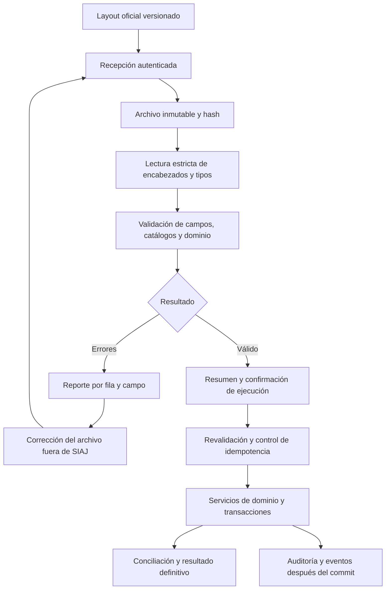

# Resumen Ejecutivo

**Recomendación: retirar el asistente de migración, sus APIs, almacenamiento intermedio y autenticación mediante clave de migración. Construir la carga masiva como un módulo independiente con layouts versionados y validación estricta.** Conservar los servicios de dominio, los datos de operación y la infraestructura compartida.

Fecha: 7 de septiembre de 2026. Alcance ejecutado: análisis estático del directorio de trabajo, incluyendo cambios locales, esquema SQL, modelos, servicios, controladores, seguridad, vistas, scripts y pruebas. No se consultó una instancia de base de datos ni se ejecutó una importación. Este documento es la propuesta de retiro solicitada; **el código y las tablas todavía no se han eliminado**.

La sustitución afecta el contrato de entrada: el usuario completa un formato oficial; SIAJ valida campos definidos. No debe reconstruirse el asistente de inferencia, homologación interactiva y edición de datos detectados. La confirmación propuesta es una autorización de ejecución sobre un archivo validado e inmutable, no un nuevo asistente de interpretación.

## Estado Actual

### Flujo observado

1. `MigrationApiController` recibe JSON individual o en lote para audiencias y términos, con `X-API-KEY`.
2. `LoteMigracionService` almacena registros en un lote pendiente y extrae nombres de catálogos para homologarlos.
3. `AdminImportController` muestra cuatro pasos: catálogos, expedientes, audiencias y términos. Permite editar, corregir, rechazar e inyectar.
4. La inyección crea o busca usuarios, catálogos y expedientes, y guarda audiencias/términos en transacciones por grupo de expediente.
5. La pantalla consulta cada cinco segundos si hay nuevos lotes. Los comentarios y la interfaz mencionan n8n; no se ha verificado una instalación ni sus flujos externos.

El antecedente funcional describe una carga Excel completa; **el código actual no demuestra ese flujo de extremo a extremo**. La pantalla de inicio muestra un botón para iniciar un lote de prueba, sin selector de archivo en ese formulario. `ImportService` de audiencias sólo recorre filas; no persiste. `TerminoImportService` sí interpreta siete columnas, pero no se encontraron invocaciones desde controladores. Las descargas de plantillas generan texto delimitado con extensión `.xlsx`, no un libro Excel real.

### Hallazgos que impiden reutilizar el importador sin rediseño

| Hallazgo observado | Consecuencia para el nuevo módulo |
| --- | --- |
| `JwtAuthenticationFilter` acepta la clave de migración y construye el principal `n8n_system` con autoridad `ADMIN`, sin condición de ruta en ese bloque | Eliminar también esta vía de autenticación; quitar únicamente `/api/migration/**` deja capacidad de autenticación residual |
| `parseDate` sustituye fecha ausente/inválida por hoy; `parseTime` por 00:00 | Rechazar datos inválidos; ninguna sustitución silenciosa |
| Estado de audiencia/término calculado como concluido si la fecha es anterior a hoy | El estado debe venir del contrato o del flujo autorizado; antigüedad no demuestra conclusión |
| Excepciones pueden terminar marcando registros `PROCESADO` y lote `COMPLETADO` | Resultado de carga debe conciliarse con confirmaciones de persistencia |
| Campos truncados y expediente limitado a 100 en importador, mientras `expedientes.numero` admite 50 en dump | Una única definición de longitudes; rechazar excedentes antes de persistir |
| Lote pendiente recuperado globalmente, sin filtro de propietario; finalización rechaza otros lotes pendientes | Aislar cada carga por propietario, alcance y versión; no afectar otras cargas |
| Agrupación por número/partes, selección de información representativa y creación automática de entidades | Exigir claves explícitas; no fusionar homónimos ni crear catálogos/usuarios implícitamente |
| Deduplicación inicial por número + serialización JSON; deduplicación final por subconjunto de campos | Diseñar idempotencia y clave de negocio explícitas; igualdad de JSON o fecha/hora no garantiza identidad |

## Componentes Obsoletos Identificados

Rutas Java relativas a `src/main/java/com/juridico/sistema_juridico/`; recursos relativos a `src/main/resources/`.

| Capa | Componentes confirmados | Alcance del retiro |
| --- | --- | --- |
| Pantalla | `templates/views/admin/importar.html` | Vista del asistente, scripts internos, polling y uso de `last_lote_detected` |
| Fragmentos | `templates/fragments/importar/etapa1_catalogos.html`, `etapa2_expedientes.html`, `etapa3_audiencias.html`, `etapa4_terminos.html` | Cuatro pasos completos |
| JavaScript | `static/js/asistente-migracion.js` | Edición, búsqueda, homologación, carga de catálogos y navegación del asistente |
| Menú | Bloque de “Migración Inteligente” en `templates/fragments/sidebar.html` | Sólo ese enlace y su estado `activePage == 'importar'`; preservar auditoría |
| Controlador web | `controller/AdminImportController.java` | 24 handlers: pantalla, pasos, plantillas, edición y APIs auxiliares |
| API externa | `controller/api/MigrationApiController.java` | Cuatro endpoints JSON bajo `/api/migration` |
| Servicios | `service/procesal/LoteMigracionService.java`, `service/procesal/TerminoImportService.java`, `service/ImportService.java` | Retirar implementación ETL, lector legado y esqueleto de lector |
| Entidades | `Entity/procesal/LoteMigracion.java`, `RegistroMigracion.java`, `CatalogoMigracion.java` | Tres modelos exclusivos del almacenamiento intermedio |
| Repositorios | `repository/procesal/LoteMigracionRepository.java`, `RegistroMigracionRepository.java`, `CatalogoMigracionRepository.java` | Tres repositorios exclusivos |
| Seguridad | Bloque `migrationApiKey`, lectura `X-API-KEY`, principal `n8n_system` y `esApiKeyValida` en `security/JwtAuthenticationFilter.java` | Refactorizar el filtro, no eliminar JWT |
| Seguridad HTTP | Excepción `permitAll` para `/api/migration/**` en `config/SecurityConfig.java` | Retirar excepción; conservar protección `/admin/**` |
| Configuración | `migration.api.key` en `application.properties`; `MIGRATION_API_KEY` en `.env.example` y `deploy/app/siaj.env.example` | Retirar propiedad y ejemplos; revocar/eliminar secreto desplegado durante corte |
| Base de datos | `registros_migracion`, `catalogos_migracion`, `lotes_migracion` | Archivar y después retirar con script versionado específico |
| SQL auxiliar | Bloque de migración en `src/main/resources/limpiar_datos.sql` | Quitar referencias a tablas retiradas; no ejecutar el script general |
| Pruebas E2E | `tests_e2e/config/roles.py`, `pages/dashboard_page.py`, `tests/test_resilience_phase4.py`, `generate_dashboard.py` | Sustituir expectativas de disponibilidad por pruebas de retiro |
| Documentación/herramientas | Matrices y reportes de pruebas en `docs/`; `tools/build_data_dictionary_docx.py`; snapshots `db_schema_actual.sql/json` | Marcar antecedentes como históricos y regenerar documentación vigente tras el cambio |
| Jobs | No se encontró `@Scheduled` ni `@Async` en el servicio de migración | No retirar schedulers operativos por similitud de nombre; investigar jobs externos n8n |

### Superficie HTTP a retirar

Todos los siguientes sufijos pertenecen a `/admin/importar`:

| Método | Sufijos |
| --- | --- |
| GET | ruta base; `/plantilla/terminos`; `/plantilla/audiencias`; `/api/buscar-expedientes-similares`; `/api/materias-por-gerencia/{gerenciaId}`; `/api/usuarios-por-materia/{materiaId}`; `/api/usuarios-por-gerencia/{gerenciaId}`; `/api/organos-por-gerencia/{gerenciaId}`; `/api/tipos-audiencia-por-gerencia/{gerenciaId}`; `/api/estado-lote`; `/api/todos-abogados` |
| POST | `/iniciar`; `/avanzar`; `/retroceder`; `/guardar-gerencia-global`; `/cancelar`; `/mapear-catalogos`; `/validar-expedientes`; `/validar-audiencias`; `/inyectar`; `/corregir-materias`; `/editar-registro`; `/api/actualizar-catalogo-texto`; `/api/asignar-materia-abogado` |

API externa: `POST /api/migration/terminos`, `/audiencias`, `/lote/terminos`, `/lote/audiencias`. Sus respuestas de recepción no prueban que los datos se hayan aplicado.

### Roles y permisos

- `ADMIN` controla el menú y `/admin/**`; también protege auditoría y administración. **Conservar todos los roles de `RolUsuario`.** No hay un rol exclusivo de migración identificado.
- `ADMIN_PANEL` es un permiso general de `PermisoSistema`, también almacenado potencialmente en `usuario_permisos_adicionales`. No borrarlo por asociación de nombre; revisar su semántica general y asignaciones. La regla HTTP del asistente usa `ADMIN`, no `PERM_ADMIN_PANEL`.
- `n8n_system` es un principal sintético del filtro; no presupone una fila de `usuarios`. Eliminar su creación, no usuarios por coincidencia de nombre.

### Dependencias de base de datos

En el dump: `registros_migracion.lote_id` y `catalogos_migracion.lote_id` referencian `lotes_migracion.id`; el lote referencia `usuarios.id` y `gerencias.id`. No se encontraron FK desde tablas operativas hacia las tres tablas del asistente. `catalogos_migracion.id_mapeado` es un identificador polimórfico, sin FK que garantice la entidad destino.

No se encontraron triggers del dump dedicados a esas tablas. Esta evidencia local debe cotejarse con vistas, funciones, FK, permisos y consumidores de la base desplegada. Los índices y secuencias propios deben incluirse en el inventario de retiro.

## Componentes Reutilizables

| Componente | Reutilización recomendada | Límite |
| --- | --- | --- |
| Modelos/repositorios de expedientes, audiencias, términos, usuarios y catálogos | Dominio y persistencia existentes | No eliminar registros históricos porque se originaron en una migración |
| `UsuarioService`, `UsuarioIdentityService`, `PasswordPolicyService`, `PermisoUsuarioService` | Identidad, unicidad, jerarquía y autorización | No copiar creación automática de abogados del ETL |
| `ExpedienteService`, `AudienciaService`, `TerminoService` | Operaciones de dominio | Extraer validaciones que hoy están en controladores; no llamar controladores desde importadores |
| `TipoTerminoService`, servicios de alertas/semáforo | Reglas de configuración | Resolver primero diferencias JPA/DDL |
| `AuditoriaService`, `AuditoriaTecnicaService`, actividades y bitácoras | Trazabilidad de quién hizo qué | Agregar correlación de carga y resultados, sin reutilizar estados defectuosos del ETL |
| `FileStorageService`, `DocumentoService`, `TerminoArchivoService`, `CarpetaService` | Almacenamiento y metadatos de adjuntos | Un nombre de archivo o URL en Excel no incorpora el binario |
| `poi-ooxml` en `pom.xml` | Lectura/generación de XLSX | Conservar: `AudienciaExcelExporter`, `TerminoExcelExporter`, `ExpedienteExcelExporter`, `ExpedienteTrazabilidadExcelExporter` ya lo usan |
| Jackson, Spring MVC, JPA, transacciones, Bean Validation, BCrypt | Infraestructura compartida | No quitar dependencias por uso en `LoteMigracionService` |
| Contextos de audiencia/término y expedientes temporales | Asuntos únicos y operaciones actuales | Se usan en controladores y archivos de términos; no son exclusivos de migración |
| `audiencias_desahogadas`, `terminos_presentados`, historial de etapas | Resultados operativos y sincronización | Conservar; no confundirlos con staging |
| Notificaciones, realtime y schedulers | Operación normal | Definir publicación posterior al commit y agrupación por carga |

Revisar métodos añadidos a repositorios compartidos. `findByExpedienteAndAsuntoAndFechaVencimiento`, `findByExpedienteAndFechaAudienciaAndHoraAudiencia` y `findTop10ByNumeroContainingIgnoreCase` aparecen como candidatos a retiro si desaparecen todos sus llamadores. `findByNumeroIgnoreCase` tiene otros usos; `findByNumeroIgnoreCaseAndPartesIgnoreCase` también aparece en `ExpedientesController`; `findByNumeroIgnoreCaseAndEsTemporal` se usa en asuntos únicos. No borrar repositorios completos ni métodos compartidos.

### Reglas funcionales a rescatar

| Regla/conocimiento | Decisión |
| --- | --- |
| Catálogos por gerencia, materia y actividad | Conservar la regla en un resolvedor de claves exactas, con control de acceso |
| Normalización de identidad y unicidad | Conservar mediante los servicios de usuarios |
| Relación usuario–materia–gerencia | Validar explícitamente; cualquier alta de asignación requiere operación declarada |
| Identificación de expediente y asociación de eventos | Conservar relaciones; redefinir clave de negocio, no reutilizar heurísticas |
| Detección de duplicados | Conservar el objetivo; implementar restricciones/idempotencia acordadas |
| Separación de recepción y aplicación | Conservar como ciclo técnico de carga, sin homologación interactiva ni creación inferida |
| Informe de errores por registro | Reimplementar con resultado fiable, fila/campo y código; no basarlo en `PROCESADO` legado |
| Mapeos históricos | Archivarlos como evidencia; sólo convertir equivalencias revisadas en catálogos oficiales |
| Inferencia de usuario/materia, moda, truncamientos, fechas por defecto y conclusión por fecha | Descartar |

## Riesgos de Eliminación

| Riesgo | Impacto estimado | Mitigación / condición de salida |
| --- | --- | --- |
| Retirar pantalla y dejar clave maestra | Alto: autenticación residual fuera de migración | Eliminar rama completa del filtro y probar que la clave antigua no autentica |
| Eliminar regla general `/admin/**` o rol ADMIN | Alto: administración y auditoría | Preservar reglas generales y probar ambos módulos |
| Retirar POI o repositorios compartidos | Alto: compilación y exportaciones | Conservar librería y verificar cuatro exportadores |
| Borrar datos de negocio creados por ETL | Alto: pérdida funcional | Preservar expedientes, usuarios, catálogos, audiencias y términos; reconciliar por separado |
| Borrar staging con lotes sin atender | Alto: pérdida de fuente/evidencia | Censar estados, archivar origen y resultado, decidir disposición de pendientes |
| API utilizada por n8n u otros clientes | Medio/alto, volumen desconocido | Inventariar consumidores, detener envíos y reintentos, comunicar fecha de corte |
| `ddl-auto=update` y entidades aún presentes | Alto: recreación o divergencia de esquema | Desplegar aplicación sin modelos obsoletos antes del retiro físico; verificar arranque posterior |
| SQL general de limpieza contiene TRUNCATE CASCADE operativos | Alto | No usarlo para el retiro; script dedicado sin CASCADE |
| Pruebas apuntan a API inexistente | Medio: falsa cobertura | Corregir prueba que usa `/api/migracion/expedientes`; rutas reales usan `/api/migration` |
| JPA y dump desactualizados entre sí | Alto para layouts | Obtener esquema real y contrato de versión antes de implementar |
| Validaciones sólo en interfaz/controlador | Alto: carga elude reglas | Centralizar en servicios y cubrir con pruebas de dominio |
| Confirmación ejecutada dos veces o cambios entre validar y aplicar | Alto: duplicados/datos inconsistentes | Clave de idempotencia, transición atómica, hash inmutable y revalidación al ejecutar |

Los impactos son cualitativos; no hay métricas de uso, volúmenes ni inventario de clientes externos para estimar duración de corte o costo en días.

## Plan de Limpieza Técnica

| Componente | Acción | Justificación |
| --- | --- | --- |
| Decisión de arquitectura | Registrar sustitución y congelar nuevas funcionalidades ETL | Evitar que layouts oficiales hereden el contrato obsoleto |
| Clientes externos y lotes | Inventariar, detener ingestión y conciliar pendientes | Permitir retiro sin pérdida de solicitudes |
| Pantalla, cuatro fragmentos y JS | Eliminar en una misma entrega | Evitar vistas/recursos huérfanos |
| Sidebar | Retirar sólo entrada de migración | Conservar administración y auditoría |
| Dos controladores | Eliminar y retirar 28 handlers | Cerrar interfaz y canales externos |
| Tres servicios exclusivos | Eliminar | No mantener rutas alternativas para importación heurística |
| Tres repositorios y tres entidades ETL | Eliminar coordinadamente | Evitar errores de inyección y recreación de tablas |
| JWT | Quitar autenticación por clave de migración y sus imports exclusivos | Retiro efectivo de credencial privilegiada |
| SecurityConfig | Quitar excepción `/api/migration/**`; conservar autenticación normal | Cerrar privilegios residuales sin afectar otros módulos |
| Propiedades, ejemplos y secretos desplegados | Quitar referencias y revocar secreto en corte | No mantener configuración sin dueño |
| Repositorios operativos | Revisar y quitar sólo métodos sin consumidores | Reducir código muerto sin romper consultas compartidas |
| POI, Jackson, JPA y servicios de dominio | Conservar | Dependencias reales de funciones vigentes |
| Tres tablas ETL | Archivar y eliminar después de retiro aplicativo | Separar eliminación de funcionalidad de disposición de evidencia |
| `limpiar_datos.sql` | Quitar bloque de tablas ETL; no ejecutarlo | Evitar errores futuros y borrado masivo accidental |
| E2E y reportes automáticos | Actualizar navegación/roles y pruebas de rutas retiradas | El retiro cambia las expectativas de disponibilidad |
| Manuales y snapshots | Versionar información vigente y preservar antecedentes fechados | Trazabilidad, sin reescribir pruebas históricas como si no hubieran ocurrido |
| Servicios de dominio | Extraer validaciones y unificar reglas reutilizables | Base común para formulario y layout |
| Nuevo módulo de cargas | Crear paquete independiente, contratos y tablas propias | No reutilizar `paso_actual`, lote global ni estados ambiguos del ETL |

### Secuencia de despliegue y disposición de datos

1. Registrar versión desplegada, consumidores, conteos de las tres tablas, lotes pendientes, respaldo verificable y responsable de retención. Revisar dependencias reales en `pg_catalog`/`information_schema`, incluidos objetos no presentes en dump.
2. Detener ingestión antigua y finalizar o archivar explícitamente pendientes. No ejecutar cancelación global del servicio antiguo como sustituto de conciliación.
3. Desplegar la eliminación del módulo aplicativo, limpieza de JWT/configuración y pruebas de retiro, manteniendo temporalmente tablas inaccesibles desde la aplicación. Esta fase aún no constituye retiro físico completo.
4. Verificar operación normal y que no haya procesos que escriban staging. Con respaldo y dependencias resueltas, ejecutar script versionado específico: retirar primero `registros_migracion` y `catalogos_migracion`, después `lotes_migracion`. Usar comportamiento restrictivo; si aparece una dependencia no prevista, detener y revisarla, no añadir `CASCADE`.
5. Verificar desaparición de objetos propios, arranque sin recreación y actualización de esquema/documentación. Conservar archivo histórico fuera del esquema operativo según retención acordada.
6. Rollback: antes del retiro físico, restaurar aplicación/configuración sólo según decisión de despliegue; después del retiro físico requiere restaurar respaldo y versión compatible. No prometer rollback de datos recreando tablas vacías ni borrar datos operativos para “deshacer migración”.

### Criterios de aceptación de la limpieza

- Compilación y arranque sin entidades/repositorios ETL ni fallos de inyección.
- No existe menú, vista, recurso JS ni handler del módulo antiguo. Buscar referencias ejecutables residuales, distinguiendo documentación histórica.
- Rutas retiradas no ejecutan lógica para ningún rol. Para sesión válida, ausencia de handler normalmente resulta en 404; para anónimos puede aplicarse primero 401/403/redirección. Si se requiere 410 temporal, hacerlo como aviso acotado en el borde y retirarlo después.
- `X-API-KEY` antigua no autentica contra ninguna ruta; JWT, sesión y auditoría siguen operando.
- Exportaciones de expedientes, trazabilidad, términos y audiencias siguen generando XLSX reales.
- Pruebas de CRUD operativo, asuntos únicos, archivos, catálogos, asignaciones y notificaciones no presentan regresiones.
- Datos operativos preservados y staging archivado/retirado; no recreación con Hibernate.
- Flujos externos detenidos y secretos retirados. Sólo entonces declarar “módulo retirado completamente”.

## Arquitectura Recomendada para Layouts

### Diseño dentro del monolito actual

Crear un módulo `carga` con controladores delgados, contratos versionados y validadores por entidad. Mantener los servicios de dominio como único punto de aplicación. No es necesario introducir microservicios ni un intermediario de mensajes para el primer alcance. Para volúmenes grandes, usar un worker con estado durable y recuperación; decidir su dimensionamiento con datos de volumen.

| Etapa | Contrato recomendado |
| --- | --- |
| Publicación | `layout_codigo`, versión, entidad, operación permitida, encabezados, tipos, límites, obligatoriedad, claves, catálogos, dependencias y ejemplos. Plantilla y validador derivados de la misma definición |
| Recepción | XLSX auténtico para usuarios; CSV sólo cuando se defina contrato específico. Verificar formato real, tamaño, hojas, número de filas, límites de descompresión y archivo vacío. Rechazar fórmulas/macros para datos de carga |
| Identidad/alcance | Usuario autenticado, permisos por entidad y operación, gerencias/materias autorizadas. Nuevos permisos propuestos `CARGAS_CREAR`, `CARGAS_EJECUTAR`, `CARGAS_VER`; no existen aún. Si hay cuenta técnica, privilegios acotados, sin ADMIN implícito |
| Archivo | Guardar nombre original, ubicación controlada, hash, tamaño, emisor y fecha. No permitir reemplazar contenido después de validar |
| Lectura | Parser por versión sin detección heurística; preservar ceros, distinguir vacío de cero/false, fechas estrictas y máximo de caracteres |
| Validación estructural | Versión soportada, encabezados exactos, columnas obligatorias, ausencia de columnas ambiguas y claves de fila |
| Validación de campo | Nulabilidad efectiva, rangos, formatos, longitudes, enums; rechazar en lugar de truncar o completar silenciosamente |
| Catálogos | Resolver por ID o clave estable del destino, con catálogo vigente y alcance. Homologaciones externas aprobadas, nunca creación automática durante validación |
| Dominio | Coherencia materia/gerencia/responsable, relaciones, etapas, transiciones, permisos, duplicados y estado activo |
| Errores | Archivo descargable con carga, hoja, fila, columna, código, mensaje y corrección sugerida. Valores sensibles minimizados; nunca exponer secretos o stack traces |
| Confirmación | Resumen de entidad, altas/actualizaciones, válidos/errores y alcance. Sólo ejecutar archivo validado con el mismo hash; confirmar una vez. Si carga es operada por administrador, no requiere construir un asistente para el usuario final |
| Ejecución | Manejador por entidad que llama servicios. Revalidar referencias/duplicados al aplicar, bloquear transición de estado y registrar idempotencia |
| Transacciones | Para primer alcance acotado, todo-o-nada por archivo. Si volumen requiere fragmentos, definir unidades de negocio atómicas y estado PARCIAL explícito; no mezclar ambos contratos silenciosamente |
| Adjuntos | Manifiesto separado y binarios. Cargar temporalmente, validar, persistir referencia y finalizar almacenamiento; limpiar temporales o compensar fallos sin dejar referencias rotas |
| Eventos | Publicar notificaciones y realtime después del commit; para garantía de entrega, outbox transaccional. Definir resumen por lote para evitar duplicación masiva |
| Resultado | Cantidades verificables de insertados, actualizados, omitidos justificados y rechazados; referencia de fila a ID destino. Nunca éxito por ausencia de excepción visible |
| Auditoría | Usuario real, alcance, operación, hash, versión de layout/validador, tiempos, confirmación, resultado y correlación con cambios. Conservar historial de intentos sin sobrescribirlo |

### Modelo técnico propuesto, no existente

| Objeto | Contenido mínimo |
| --- | --- |
| `cargas_masivas` | ID, código/versión de layout, operación, hash de archivo, propietario, alcance, estado, versión optimista, totales, fechas de recepción/validación/confirmación/fin y versión del validador |
| `carga_filas` | Carga, hoja, fila, clave de origen, resultado, acción e ID destino; unicidad de fila dentro de carga |
| `carga_errores` | Carga/fila/campo, código, mensaje seguro, severidad y fecha |
| `carga_equivalencias` | Sistema origen, entidad, clave origen, ID destino y versión/fecha; sólo si las fuentes no usan claves del destino |
| Registro versionado de layouts | Definición de captura y validación; puede residir en código/configuración versionada, sin tabla editable inicial |

Estados propuestos: RECIBIDA → VALIDANDO → INVALIDA o VALIDADA → EJECUTANDO → COMPLETADA/FALLIDA. CANCELADA sólo antes de ejecutar; VALIDACION_VENCIDA cuando cambió contexto o caducó la validación. PARCIAL sólo si se autoriza ejecución por fragmentos. Caídas deben dejar estado recuperable mediante intento/lease; no “completar” por timeout.

La idempotencia debe combinar una clave de solicitud con ámbito, entidad, versión y operación; además aplicar claves/UNIQUE de negocio aprobadas. El hash identifica contenido, pero por sí solo no decide si un archivo similar representa una operación nueva. Reintentar una carga completada devuelve su resultado previo; una actualización nueva necesita operación y versión explícitas.

El primer alcance recomendado es **alta controlada**. Actualización, baja y restauración requieren contratos distintos; no implementar un upsert genérico por número o nombre.

## Información Pendiente por Definir

### Entregables funcionales y de datos

| Entregable | Información que debe contener | Responsable sugerido |
| --- | --- | --- |
| Inventario de entidades | Módulo, tabla/modelo, operación de carga, dueño, clave, campos técnicos excluidos, volumen, tratamiento histórico | Funcional / datos |
| Inventario de catálogos | Clave estable, descripción, vigencia/activo, gerencia, materia, propietario, jerarquía, equivalencias y orden previo | Administrador funcional |
| Diccionario de campos | Campo/columna, descripción, tipo, máximo, obligatorio BD/aplicación/condicional, ejemplo, normalización, enum y fuente | Datos / técnico |
| Matriz de relaciones | Cardinalidad, FK, clave de referencia, orden de carga, circularidades, padres/hijos y política ante ausentes | Arquitectura / datos |
| Matriz de validaciones | Regla numerada, condición, fuente, severidad, código de error y casos válidos/inválidos | Funcional / QA |
| Matriz de autorizaciones | Quién carga, confirma, consulta y descarga errores por entidad, rol y alcance | Funcional / seguridad de aplicación |
| Contrato operativo | Volúmenes, formatos, frecuencia, zona horaria, límites, retención, concurrencia, atomicidad y reintentos | Operación / técnico |
| Conciliación del retiro | Consumidores externos, staging pendiente, respaldo, retención y corte | Operación / DBA |

### Recomendaciones por layout

| Layout | Base confirmada | Decisiones antes de oficializar |
| --- | --- | --- |
| Usuarios | Nombre máximo 200, email 100, username 80, número empleado 40, rol; relaciones usuario–gerencias y usuario–materias | Email NOT NULL en dump pero opcional en modelo/script de despliegue. Identidad de carga y unicidad case-insensitive. Activación fuera de Excel; no hashes, claves o tokens |
| Expedientes | Número 50, descripción, materia, gerencia, etapa; IDs UUID | Número no es UNIQUE en dump. Definir identidad de negocio, tipo y etapa configurables, referencias a responsable y manejo de homónimos |
| Audiencias | Expediente, fecha, hora; tipo obligatorio en controlador; compareciente/delegado, lugar/virtualidad | Estado explícito y evidencia para conclusión; duplicados; contexto de asunto único con expediente temporal; no concluir por fecha |
| Términos | Asunto requerido por controlador, vencimiento, estado y responsable; expediente o contexto | Tipo de término, calendario hábil/natural, fecha base, presentación/acuse, prioridad y transiciones. No inferir cómputo jurídico sin definición funcional |
| Catálogos | Gerencias, materias, estados/sedes, prioridades, tipos de expediente/audiencia, órganos jurisdiccionales | Claves y alcance de unicidad; activos; jerarquías. `tipos_termino`, `cat_etapas_procesales` aparecen en JPA y no en dump revisado |
| Entidades relacionadas | Asignaciones de usuario, colaboradores, carpetas, documentos, archivos de término, comentarios, recordatorios, eventos manuales, alertas y preferencias | Separar captura manual, resultados derivados y migración histórica. Orden padre/hijo, binarios y alcance de autorización |
| Actores y demandados | `expedientes.partes` es texto libre; no se encontraron tablas independientes | Definir modelo estructurado si se requiere identificación por persona; no inventar campos como RFC/CURP ni unicidad |
| Salas y juzgados | `organos_jurisdiccionales` y `audiencias.sala_lugar` | Distinguir autoridad jurisdiccional de recinto físico; no crear dos catálogos equivalentes |
| Organismos | No existe correspondencia inequívoca | Precisar si son partes, autoridades o unidades administrativas antes de diseñar persistencia |

Diferencias adicionales: el DTO legado `asuntoId` Integer no corresponde a UUID de expediente; `terminos.prioridad`/`archivo_word` del dump no equivalen automáticamente a relaciones/archivos del modelo; hay períodos de etapas y nuevos campos de término ausentes del dump. Las FK y validaciones deben salir del esquema desplegado reconciliado, no sólo de plantillas antiguas.

Las hojas del estudio preliminar de layouts que describen APIs históricas o Excel legado quedan **como referencia obsoleta y no como contratos oficiales** por la decisión de retiro de este documento. Los layouts oficiales todavía requieren aprobación de las definiciones anteriores e implementación de sus validadores.

## Próximos Pasos Recomendados

1. **P0 — Asegurar el corte:** identificar consumidores de la clave y API, lotes pendientes, esquema real y política de archivo. Registrar la decisión de retiro.
2. **P1 — Retirar aplicación y credencial:** una entrega coordinada con UI, controladores, servicios, modelos/repositorios ETL, JWT, configuración y pruebas de regresión; preservar dominio, POI y auditoría.
3. **P1 — Retirar almacenamiento obsoleto:** después del archivo y verificación de corte, aplicar script restrictivo dedicado y comprobar que no se recrean tablas.
4. **P1 — Consolidar inventarios:** reconciliar JPA/DDL y resolver identidad de expediente, usuarios sin correo, catálogos y asuntos únicos.
5. **P2 — Formalizar contratos:** versiones iniciales de catálogos, usuarios/asignaciones, expedientes, audiencias y términos; incluir adjuntos y estados cuando aplique.
6. **P2 — Construir núcleo de cargas:** recepción, validación sin efectos operativos, errores, confirmación, idempotencia, ejecución y auditoría.
7. **P2 — Pilotear:** archivos ficticios con filas válidas/erróneas, reintentos, cambio concurrente de catálogo, caída de proceso y cancelación antes de ejecución. Conciliar resultado real.
8. **P3 — Extender:** archivos y entidades relacionadas; dimensionar worker y transacciones por fragmentos sólo con volúmenes conocidos.

### Evidencia local principal

Las rutas se refieren al estado de trabajo analizado, no necesariamente a una versión productiva.

- `controller/AdminImportController.java:30` y `:197`: rutas del asistente y descargas simuladas.
- `controller/api/MigrationApiController.java:16`: cuatro endpoints externos y validación de clave.
- `service/procesal/LoteMigracionService.java:69`, `:117`, `:1427`, `:1645`, `:1760`, `:2273`, `:2304`: lote global, deduplicación, inyección, estados y tratamiento de fechas/errores.
- `security/JwtAuthenticationFilter.java:33`, `:54`, `:108`: clave y principal con ADMIN.
- `config/SecurityConfig.java`: protección general de administración y excepción de API antigua.
- `templates/views/admin/importar.html:49`, `:198`: botón de prueba y polling.
- `templates/fragments/sidebar.html:176`: entrada de migración junto a auditoría.
- `service/ImportService.java`, `service/procesal/TerminoImportService.java`: lectores legado/incompleto.
- `pom.xml:115` y `util/*ExcelExporter.java`: dependencia POI compartida.
- `db_schema_actual.sql:678`, `:982`, `:1261` y secciones de restricciones: tres tablas de staging.
- `src/main/resources/application.properties:13`, `:66`: actualización Hibernate y clave de migración.
- `src/main/resources/limpiar_datos.sql:38`: bloque de limpieza de staging dentro de un script más amplio.
- `tests_e2e/tests/test_resilience_phase4.py:111`: prueba de API con ruta distinta a las rutas reales.

Verificación realizada: búsqueda de referencias y lectura cruzada de componentes, contratos y DDL. No se ejecutaron pruebas de compilación ni funcionales porque esta entrega no modifica código operativo; esas pruebas son condición de aceptación de la implementación del retiro.
